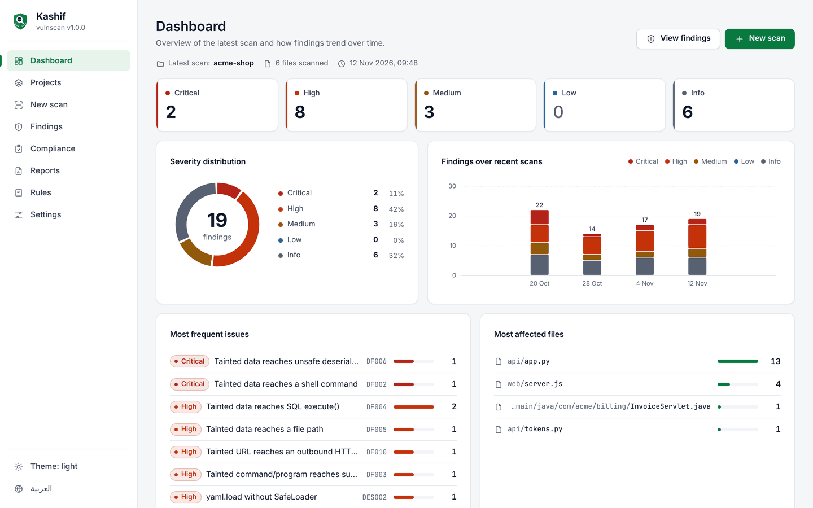
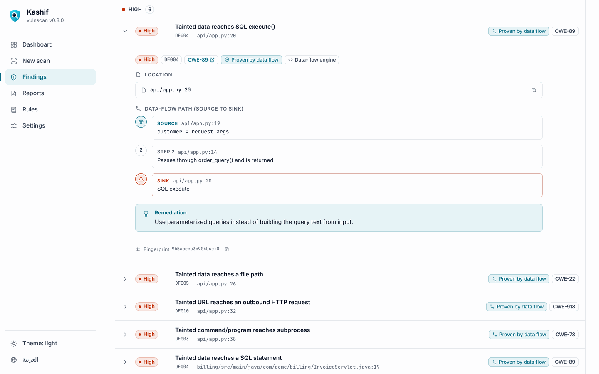
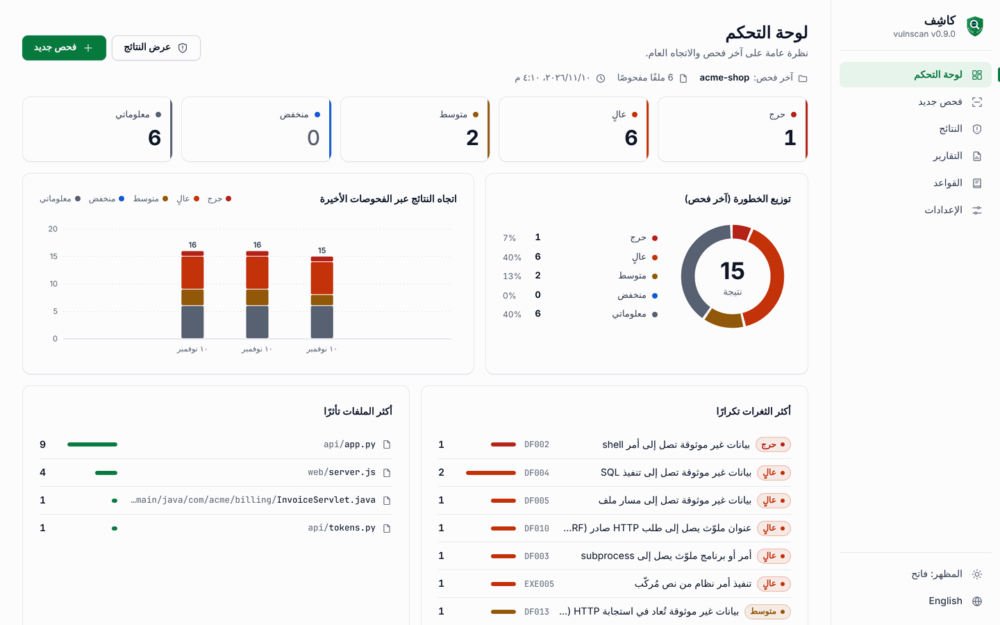
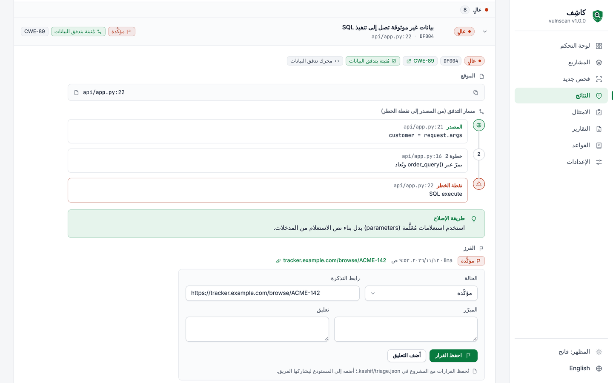
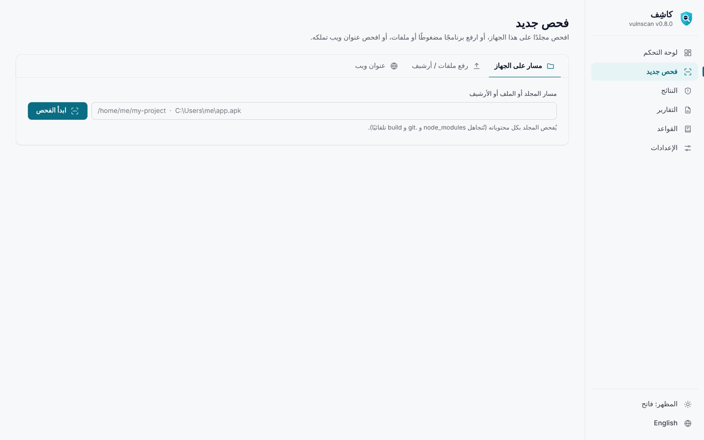
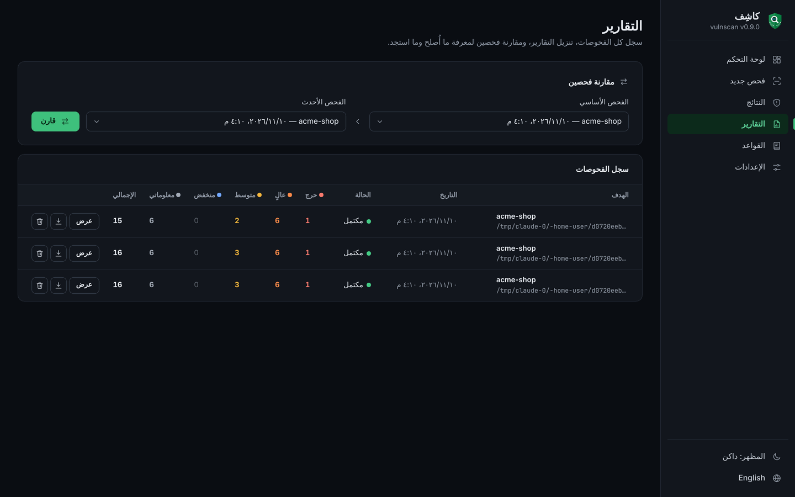

<p align="center">
  
</p>

<p align="center">
  <b>English</b> | <a href="#arabic">العربية</a>
  &nbsp;·&nbsp; <a href="https://abdulrahmanahmedelabed-prog.github.io/vulnscan/">Website</a>
  &nbsp;·&nbsp; <a href="https://github.com/abdulrahmanahmedelabed-prog/vulnscan/releases/latest">Download</a>
</p>

<a id="english"></a>

# Kashif (vulnscan) — open-source SAST with real dataflow analysis

**Kashif** (كاشِف, "the revealer") is a dependency-free static application security testing tool written in
Python. `kashif` is the name of the command (`vulnscan`, its earlier name and the Python package's, still works as
an alias). It scans source code, archives, Android apps
and (passively) websites, and produces a report ordered from **critical to info**, from the command line or
from a **local web UI** in English and Arabic.

| Dashboard | Finding with its data-flow trace |
|---|---|
|  |  |

> **Authorization first:** scan only what you own or are authorized in writing to test. Scanning other
> people's systems without permission may be illegal. Web targets require the `--authorized` flag.

## What it does

- **Dataflow (taint) analysis in 12 languages** — Python, JavaScript/TypeScript, Java, Kotlin, C#, Go, PHP,
  C/C++, Rust, Swift, Ruby and PL/SQL. Untrusted input is tracked across functions, classes and files, and
  every finding carries the full source → sink path.
- **Precision features** — flow-sensitive analysis with constant folding and dead-branch pruning;
  context-sensitive (k=2) points-to analysis; context-specific sanitizers (`html.escape` protects HTML only,
  not SQL or a shell); second-order (stored) injection through database tables.
- **Rules and models** — 153 pattern rules, 48 dataflow and APEX rules and 19 built-in VQL queries (VQL is
  Kashif's declarative query language over the program database), over 6,354 modelled library APIs
  (1,044 sources, 4,531 sinks, 779 sanitizers).
- **Fewer false positives on real code** — test, documentation and example code is recognised by its path: fixture
  noise there is dropped and the rest is lowered to info; vendored bundles are skipped. On the 35 open-source projects
  (of 38) that 0.9 could finish, findings went from 17,228 to 2,607 (critical and high: 4,345 to 783); half of 0.9's
  findings were in test, docs and example code.
- **Fast on large code** — `--jobs N` spreads the per-file work over your CPUs and `--cache DIR` answers an unchanged
  project from its cache with identical findings. Django (6,973 files) takes 311–411 s cold on 4 vCPUs (0.9: 594 s)
  and 3.5 s warm.
- **Autofix** — `--fix` / `--fix-dry-run` apply verified, deterministic fixes for 39 rules (38 automatically), shown as
  diffs in the UI, the reports, SARIF and the editor.
- **Oracle APEX & ORDS** — APEX application exports, plug-ins and PL/SQL packages.
- **Secrets** — provider-specific patterns plus entropy-based detection, and `kashif history` for every secret ever
  committed to git, even if a later commit deleted it.
- **Dependencies (SCA) with reachability** — 23 manifest and lockfile types; known vulnerabilities from
  [OSV.dev](https://osv.dev), each marked by whether your code imports the package and calls the vulnerable function
  (the OSV lookup is optional and the only part of a code scan that uses the network).
- **Archives & Android** — zip, tar.gz, whl, APK, JAR, AAR, DEX; with [jadx](https://github.com/skylot/jadx)
  installed, bytecode is decompiled and analyzed.
- **Passive web scanning** — security headers, CSP, TLS, cookies, commonly exposed paths, and a crawl with
  rate limiting and an honest User-Agent. No payloads, no form submission.
- **Team workflow** — triage decisions kept in the repository (`kashif triage`), policy as code (`kashif.yml`),
  compliance mapping to 10 frameworks with an auditor report (`kashif compliance`), an attack-surface map
  (`kashif surface`) and a kit to write and test your own rules (`kashif rules`).
- **AI coding assistants** — `kashif mcp` is an MCP server, so Claude Code, Cursor, VS Code agents, Windsurf and Zed
  can check the code they write, locally and offline.
- **Outputs** — console, Markdown, JSON, HTML and SARIF 2.1.0 (validated against the OASIS schema; works with
  GitHub Code Scanning and the VS Code SARIF viewer), with stable fingerprints; plus DefectDojo, SonarQube,
  GitLab SAST, Code Climate, JUnit XML, CSV, Jira, GitHub Issues, AWS Security Hub (ASFF) and OCSF.

## Install

### One line (verifies the SHA-256 before installing)

```bash
# macOS and Linux: installs kashif (and a vulnscan alias) into ~/.local/bin
curl -fsSL https://abdulrahmanahmedelabed-prog.github.io/vulnscan/install.sh | sh
```

```powershell
# Windows: installs into %LOCALAPPDATA%\Programs\Kashif and adds it to your PATH
irm https://abdulrahmanahmedelabed-prog.github.io/vulnscan/install.ps1 | iex
```

```bash
# Homebrew (macOS and Linux)
brew tap kashif/vulnscan https://github.com/abdulrahmanahmedelabed-prog/vulnscan
brew install kashif
```

All three download the release binary over HTTPS and check it against the release's `SHA256SUMS.txt`. Because
they download with curl, macOS does not quarantine the file, so Gatekeeper does not block the (not yet notarized)
binary.

### Download a binary (nothing else needed)

Get the file for your platform from the
[latest release](https://github.com/abdulrahmanahmedelabed-prog/vulnscan/releases/latest):

| Platform | File |
|---|---|
| Windows x64 (portable) | [`kashif-windows-x86_64.exe`](https://github.com/abdulrahmanahmedelabed-prog/vulnscan/releases/latest/download/kashif-windows-x86_64.exe) — double-click to open the web UI |
| Windows x64 (setup wizard) | [`kashif-setup.exe`](https://github.com/abdulrahmanahmedelabed-prog/vulnscan/releases/latest/download/kashif-setup.exe) — installs Kashif, optionally adds it to PATH, adds Start-menu and desktop shortcuts, and uninstalls from Windows Settings |
| Linux x86-64 (Ubuntu 22.04+, Debian 12, RHEL 9+) | [`kashif-linux-x86_64`](https://github.com/abdulrahmanahmedelabed-prog/vulnscan/releases/latest/download/kashif-linux-x86_64) |
| macOS Apple Silicon | [`kashif-macos-arm64`](https://github.com/abdulrahmanahmedelabed-prog/vulnscan/releases/latest/download/kashif-macos-arm64) |
| macOS Intel | [`kashif-macos-x86_64`](https://github.com/abdulrahmanahmedelabed-prog/vulnscan/releases/latest/download/kashif-macos-x86_64) |

```bash
# Linux
chmod +x kashif-linux-x86_64
./kashif-linux-x86_64                    # opens the web UI
./kashif-linux-x86_64 ./project --fail-on high

# macOS: the binary is not notarized by Apple. Remove the quarantine flag once
# (or right-click the file > Open on first launch):
chmod +x kashif-macos-arm64
xattr -d com.apple.quarantine kashif-macos-arm64
./kashif-macos-arm64
```

**Verify the download.** Every release ships `SHA256SUMS.txt`, a CycloneDX SBOM (`kashif-sbom.cdx.json`)
and signed SLSA build provenance:

```bash
sha256sum -c SHA256SUMS.txt --ignore-missing
gh attestation verify kashif-linux-x86_64 --repo abdulrahmanahmedelabed-prog/vulnscan
```

### Install with pip (Python 3.10+)

```bash
pip install git+https://github.com/abdulrahmanahmedelabed-prog/vulnscan
```

Kashif has **zero runtime dependencies**. You can also run it from a clone with `python -m vulnscan`.

### Updating

The binaries update themselves. In the web UI open **Settings > Updates** and select **Update now**, then
**Restart now**; a small "Update available" badge appears in the sidebar when a newer release is out. From a
terminal:

```bash
kashif update            # check, confirm, download, verify, install
kashif update --check    # only check: exit code 10 when an update is available, 0 when up to date
kashif update --yes      # no confirmation prompt (scripts)
```

The update is downloaded only from GitHub over HTTPS, checked against the release's `SHA256SUMS.txt`, refused if
it is not newer, and tested (`--version`) before it atomically replaces the running binary; the previous binary is
kept as `<name>.old` until the next start, and any failure rolls back. On macOS, an Intel binary running under
Rosetta is offered the native Apple Silicon build. If the binary's folder is not writable (for example
`/usr/local/bin`), run `sudo kashif update`. pip and source installs are never modified: the UI and
`kashif update` show the exact command instead (`python -m pip install --upgrade ...` or `git pull`).
A pip install made before 1.0.2 is the distribution `vulnscan` (from 1.0.2 on it is `kashif`): remove it before
installing the new version, or the two would own the same files (`vulnscan` on PyPI is an unrelated project):

```bash
python -m pip uninstall -y vulnscan kashif
pip install git+https://github.com/abdulrahmanahmedelabed-prog/vulnscan
```
The check asks `api.github.com` for the latest release at most every 6 hours and sends nothing about your code;
turn off **Check for updates automatically** in Settings to disable it.

## Quick start

```bash
kashif ./my-project                         # colored console report
kashif ./my-project --all-formats report    # report.md / .json / .html / .sarif
kashif app.apk -f html -o report.html       # archives and APKs
kashif . --fail-on high --exclude "tests/*" # CI gate
kashif . --no-deps --no-external            # fully offline
kashif https://my-site.example --authorized # passive web scan of a site you own
kashif ui                                   # web UI on http://127.0.0.1:8765
kashif . --lang en                          # English-only output (ar, en, both; or set VULNSCAN_LANG)
```

Every finding, remediation, data-flow step and scan note is available in English and Arabic: the web UI switches
language in one click, `--lang` controls the console and the Markdown/HTML reports, and SARIF is English-first
for GitHub Code Scanning (Arabic kept in the result properties).

The web UI (dashboard, scan, findings, reports, rules, settings) listens on 127.0.0.1 only; data is stored in
`~/.vulnscan` (or `VULNSCAN_HOME`).

## Command reference

`kashif --help` lists every option and sub-command; `kashif <sub-command> --help` shows the options of one.
`python3 -m vulnscan ...` works the same way, and `vulnscan` is kept as an alias of `kashif`.

```bash
kashif . -f gitlab-sast -o gl-sast-report.json      # GitLab Security tab and merge-request widget
kashif . -f codeclimate -o gl-code-quality.json     # GitLab Code Quality
kashif . --export defectdojo=dd.json --export junit=kashif.xml   # extra formats from the same scan
kashif . --triage --fail-on high                    # honour the decisions in .kashif/triage.json
kashif . --policy strict                            # a builtin gate; a kashif.yml in the project applies by itself
kashif . --compliance owasp,pci --audit-report audit.html
kashif ui                                           # local web UI
kashif lsp                                          # language server for editors
kashif mcp                                          # MCP server for AI coding assistants
kashif export report.json -f sonarqube -o sonar.json
kashif compliance report.json -f html -o audit.html
kashif history . --max-commits 500                  # secrets in git history (alias: secrets-history)
kashif triage set <fingerprint> false_positive -j "the value is a constant"
kashif triage list
kashif policy init --preset startup                 # writes kashif.yml
kashif policy check report.json
kashif surface . -f openapi -o surface.json         # attack-surface map
kashif rules new my-pack && kashif rules test my-pack
kashif update --check
```

| Sub-command | What it does |
|---|---|
| `ui` | Local web UI on 127.0.0.1 (dashboard, scans, findings, reports, settings). |
| `lsp` | Language server: findings underlined as you type, quick fixes (setup: `editors/README.md`). |
| `mcp` | Model Context Protocol server, so Claude Code, Cursor, VS Code agents, Windsurf and Zed can check the code they write, locally and offline: `claude mcp add kashif -- kashif mcp`. `kashif mcp --print-config all` prints the configuration of each client. Tools: scan_path, scan_snippet, get_finding, explain_rule, list_rules, suggest_fix. It reads only inside the project roots and never runs your code. |
| `export` | Converts a JSON report (`-f json`) to DefectDojo, SonarQube, JUnit XML, CSV, Jira CSV, GitHub Issues, AWS Security Hub (ASFF), OCSF, GitLab SAST, Code Climate or the Kashif risk score (`kashif export --list-formats`). The scan's own `-f` accepts the same formats. The risk score (0-10) is a triage aid, not a CVSS score. |
| `compliance` | Maps findings (a JSON report, a SARIF file of any tool, or a path to scan) to OWASP Top 10, OWASP API Top 10, ASVS, CWE Top 25, PCI DSS, NIST SSDF, NIST SP 800-53, ISO/IEC 27001, HIPAA and GDPR, and writes a printable auditor report. Evidence for an assessment, not a certification. |
| `history` | Every secret ever committed, even if a later commit deleted it, with the commit that introduced it and whether it is still at HEAD. Secrets are always redacted. Needs only the `git` executable. |
| `triage` | Decisions about findings (false positive, accepted risk with an expiry date, won't fix, fixed) in `.kashif/triage.json`, with author, justification and an audit log, reviewed in pull requests like code. `kashif triage stats` reports MTTR, ages and SLA breaches. |
| `policy` | Policy as code: a `kashif.yml` gate (severity thresholds, counts, new findings only, forbidden CWEs/rules/OWASP categories, per-path scopes, exceptions with an approver and an expiry). `kashif policy check report.json` explains each decision. |
| `surface` | Attack-surface map: HTTP routes, CLI commands, queue consumers and jobs with their untrusted inputs, the visible authentication and the sinks they reach; Markdown, CSV, JSON, Mermaid, Graphviz or an OpenAPI 3.1 skeleton. Static analysis only. |
| `rules` | Write and test your own rules: `new` scaffolds a rule pack, `test` checks fixtures annotated with `# kashif: expect RULE`, `lint`, `pack` (one `.kashifpack` file with a SHA-256), `verify`, `install`, `list`, `docs`. Scan with installed packs: `--pack NAME` or `--packs`. |
| `update` | Installs the latest official release after verifying it (`--check` only checks). |
| `update-data` | `kashif update-data --web` installs the web scanner's data snapshot of the latest release after verifying its SHA-256 (`--check` only checks). Nothing about the sites you scan is sent; without it the bundled snapshot is used. |

Scan options added in 1.0: `--export FORMAT=FILE` (repeatable), `--risk-score`, `--compliance FRAMEWORKS`,
`--audit-report FILE`, `--triage[=FILE]`, `--triage-update` (CI on the main branch only), `--triage-show STATUSES`,
`--sla critical=7,high=30`, `--fail-on-sla`, `--policy[=FILE|PRESET]`, `--no-policy`, `--policy-reports-dir DIR`,
`--pack NAME`, `--packs`. A `kashif.yml` found in the scanned folder is applied automatically and decides the exit
code together with `--fail-on`; a policy or triage file in a pull request can relax the gate for that pull request,
so review changes to them like code (`kashif triage diff`).

## CI and GitHub Code Scanning (SARIF)

```yaml
permissions:
  contents: read
  security-events: write   # required to upload SARIF
steps:
  - uses: actions/checkout@v4
  - uses: actions/setup-python@v5
    with: { python-version: "3.12" }
  - run: pip install git+https://github.com/abdulrahmanahmedelabed-prog/vulnscan
  - run: kashif . --no-deps -f sarif -o vulnscan.sarif
  - uses: github/codeql-action/upload-sarif@v3
    if: always()
    with:
      sarif_file: vulnscan.sarif
```

Findings appear in the Security tab and inline on pull requests, with a numeric severity, CWE and the dataflow
path. Fingerprints are stable across line shifts and reformatting, so alerts are not duplicated.

### Pull-request review comments, GitLab, pre-commit

- **GitHub Action** (`uses: abdulrahmanahmedelabed-prog/vulnscan@v1.0.2`): scans the pull request, uploads SARIF and
  posts one review with inline comments on the changed lines only (rule, severity, remediation, data-flow path),
  plus a summary comment that is updated, not duplicated, on every push.
- **Diff-aware scanning** anywhere: `kashif . --diff-base origin/main` reports only what the branch introduces
  (the whole project is still analysed, so cross-file flows stay correct); `--fail-on` then gates on new findings only.
- **GitLab**: `-f gitlab-sast` (Security tab and merge-request widget; GitLab SAST report schema 15.0) and
  `-f codeclimate` (Code Quality); a ready GitLab CI job is in `docs/production.md`. Scan the repository root so
  that paths are relative to it.
- **pre-commit**: a `kashif` hook that checks only staged changes.

Full guide: `docs/integrations.md`.

## IDE integration (VS Code, JetBrains, Neovim, Helix, Zed, Sublime, Emacs)

`kashif lsp` is a Language Server: vulnerabilities are underlined while you work, with the data-flow path as
related locations, remediation on hover, and quick fixes to suppress a reviewed finding or add it to the baseline.
The VS Code extension (`kashif-vscode.vsix`, attached to every release) runs it for you; other editors connect to
the same server. Setup for each editor: `editors/README.md`.

### Baseline: report only what's new

```bash
kashif . --write-baseline .vulnscan-baseline.json          # once; commit the file (fingerprints only)
kashif . --baseline .vulnscan-baseline.json --fail-on high # later: new findings only
```

### Audit profile

`--audit` additionally lists every dangerous call (eval, shell, SQL, pickle, …) that dataflow analysis could
not prove is reached by untrusted input — useful for manual security reviews where you want the whole attack
surface, not just proven flows.

## Accuracy: OWASP Benchmark

Measured on the [OWASP Benchmark for Python](https://github.com/OWASP-Benchmark/BenchmarkPython) v0.1
(1,230 test cases) and the [OWASP Benchmark for Java](https://github.com/OWASP-Benchmark/BenchmarkJava) v1.2
(2,740 test cases). Score = mean over categories of TPR − FPR (Youden's J), the scoring method OWASP uses,
computed by this project's own scorer (`bench/score_owasp.py`), not by OWASP's scorecard tool.
**Python: 74.0% · Java: 98.3%.**

| Category | Py TPR % | Py FPR % | Py score | Java TPR % | Java FPR % | Java score |
|---|---:|---:|---:|---:|---:|---:|
| cmdi (command injection) | 100.0 | 42.9 | 57.1 | 100.0 | 0.0 | 100.0 |
| codeinj (code injection) | 100.0 | 45.5 | 54.5 | — | — | — |
| crypto (weak cipher) | — | — | — | 100.0 | 0.0 | 100.0 |
| deserialization (deserialization) | 100.0 | 8.3 | 91.7 | — | — | — |
| hash (weak hashing) | 100.0 | 0.0 | 100.0 | 100.0 | 0.0 | 100.0 |
| ldapi (LDAP injection) | 100.0 | 7.7 | 92.3 | 100.0 | 0.0 | 100.0 |
| pathtraver (path traversal) | 92.3 | 46.6 | 45.7 | 100.0 | 0.0 | 100.0 |
| redirect (open redirect) | 100.0 | 47.6 | 52.4 | — | — | — |
| securecookie (insecure cookie) | 100.0 | 0.0 | 100.0 | 100.0 | 0.0 | 100.0 |
| sqli (SQL injection) | 100.0 | 0.0 | 100.0 | 100.0 | 0.0 | 100.0 |
| trustbound (trust boundary) | 100.0 | 36.8 | 63.2 | 100.0 | 0.0 | 100.0 |
| weakrand (weak randomness) | 100.0 | 0.0 | 100.0 | 100.0 | 0.0 | 100.0 |
| xpathi (XPath injection) | 76.5 | 20.0 | 56.5 | 100.0 | 0.0 | 100.0 |
| xss (cross-site scripting) | 100.0 | 43.1 | 56.9 | 100.0 | 18.2 | 81.8 |
| xxe (XML external entities) | 100.0 | 35.0 | 65.0 | — | — | — |
| **Overall** | | | **74.0** | | | **98.3** |

Each suite is scanned whole, as one application (the Python repository, the Java `src/main` tree), with the
default profile. Reproduce either with one command:

```bash
git clone --depth 1 https://github.com/OWASP-Benchmark/BenchmarkPython && python bench/score_owasp.py BenchmarkPython
git clone --depth 1 https://github.com/OWASP-Benchmark/BenchmarkJava && python bench/score_owasp.py BenchmarkJava
```

The engine is never tuned to benchmark files: no test-case names, paths or expected results are encoded in
it. The weakest categories (Python path traversal, XSS and redirects) are where values need deeper tracking; that
gap is reported as measured.

**About the Java score (76.3% in 0.9 → 98.3% in 1.0).** Two general Java call-resolution fixes explain the whole
change. A bare call such as `helper(x)` now resolves to the enclosing class's own method, so the helper's body is
analysed instead of passing taint straight through (258 false positives became true negatives); and a common
library method such as `toString` or `getValue` is no longer bound to an unrelated project method of the same name
(41 missed vulnerabilities are now found). No test case moved in the wrong direction. An independent audit found no
Benchmark-specific names, paths or patterns in the engine; a fully renamed copy of the suite scores the same 98.3%,
and 516 of 516 mutation tests behaved correctly (renamed safe cases stay quiet; each one made really vulnerable is
reported). Caveats: the Benchmark is a synthetic suite, so the score is not a measure of accuracy on real code (the
same audit found engine limitations that show on real code and do not affect this score), and 38 Java XSS false
positives remain (FPR 18.2%) because HTML escaping is not credited when the escaped value is the format string of
`format`/`printf`.

## Languages and targets

| Target | Coverage |
|---|---|
| Dataflow (taint) | Python, JavaScript/TypeScript, Java, Kotlin, C#, Go, PHP, C/C++, Rust, Swift, Ruby, PL/SQL |
| Oracle | APEX application exports, plug-ins, PL/SQL packages, ORDS |
| Android / JVM | APK, JAR, AAR, DEX (decompiled with jadx when installed) |
| Config & CI | Dockerfile, docker-compose, GitHub Actions, AndroidManifest, iOS plist, config files |
| Web (passive) | headers, CSP, TLS, cookies, exposed paths, rate-limited crawl (`--authorized` required) |

## Passive web scanning

`kashif https://my-site.example --authorized` reads what a site already serves, the way a browser would, and judges
it against 184 rules (34 kept from 1.0 with the same ids, 150 new): transport and HSTS, Content-Security-Policy,
framing and the other response headers, CORS, cookies, page content and the page's own JavaScript, information
disclosure, TLS and certificates, components (retire.js data), exposed files and `security.txt`. It never sends a
payload, never submits a form, never fuzzes or guesses, never spoofs headers, sends an honest User-Agent
(`Kashif/<version>`) and keeps at least `--delay` seconds (floor 0.2) between two requests to one host.

```bash
kashif https://my-site.example --authorized                        # standard profile (at most 45 requests)
kashif https://my-site.example --authorized --web-profile minimal  # the page and its redirects only (at most 10)
kashif https://my-site.example --authorized --deep                 # + commonly exposed files (at most 150)
kashif https://my-site.example --authorized --crawl --max-pages 50 # + same-site pages, robots.txt honoured
kashif https://my-site.example --authorized --web-sensitivity strict -f sarif -o web.sarif
kashif https://my-site.example --authorized --compare-previous     # diff against the last saved scan of the site
kashif https://my-site.example --authorized --compare old-report.json
kashif update-data --web                                           # newer web data from the latest release
```

| Option | Meaning |
|---|---|
| `--web-profile minimal\|standard\|deep` | `minimal` is the 1.0 single fetch (the entry chain, at most 10 requests); `standard` (default) adds the http/https counterpart, one cookieless CORS GET with `Origin: https://kashif-cors-check.invalid`, `robots.txt`, `security.txt`, the favicon and up to 15 of the page's own scripts and styles (at most 45); `deep` (`--deep`) adds a fixed list of commonly exposed files with soft-404 baselines, third-party scripts, source maps and images (at most 150). Crawled pages come on top. |
| `--web-sensitivity strict\|default\|paranoid` | `strict` reports certain findings only, `default` certain and firm, `paranoid` everything, including the paranoid-only checks. Every finding carries its confidence (`certain`, `firm` or `tentative`). |
| `--crawl`, `--max-pages N`, `--max-depth N`, `--ignore-robots` | Breadth-first crawl of same-origin links; `robots.txt` is honoured unless you own the site and pass `--ignore-robots`. |
| `--compare-previous`, `--compare ID\|FILE` | New, resolved and unchanged findings, grade changes and posture changes ("CSP changed", "new third-party script host", "certificate renewed"). `--compare-previous` keeps the scan in the local history (`~/.vulnscan`) for the next run; `--compare` takes a scan id or a JSON report (`-f json`). |
| `--web-cookie-ignore NAME` | Leave a cookie out of the cookie checks (repeatable). |
| `--third-party-lookups` | Allow lookups that reveal the site's name to a third party (such as hstspreload.org). Off by default. |
| `--no-proxy` | Do not use `HTTP(S)_PROXY`. Through a proxy, DNS-based checks are reported as not tested and TLS findings as tentative. |

Every report shows three grades (the Kashif Web Grade A+ to F, an MDN HTTP Observatory-compatible score, and an
SSL Labs-compatible TLS grade that excludes the attack-only tests Kashif does not perform), an honest coverage table
(passed, failed, not applicable, not tested, inconclusive: a check that did not run is never shown as passed), the
site inventory (security headers, CSP, cookies, TLS, technologies, third parties), copy-paste fixes for nginx,
Apache, IIS, Caddy, Express, Django, Spring, ASP.NET Core and Cloudflare (the detected platforms first) and, with a
previous scan, the diff. SARIF results carry `properties.precision` and the tags `external/cwe/cwe-N`, `wstg:…`,
`asvs4:…` and `asvs5:…`; the JSON report has the same data under the `web` key. All rules, their mappings and
default severities are listed in [docs/web-checks.md](docs/web-checks.md); [docs/web-scanning.md](docs/web-scanning.md)
describes the traffic, the profiles and the reports. Policy files override severities and ignore rules by id as
for any other rule.

## Limitations

- Static analysis finds common patterns and flows; it does not replace human review or penetration testing.
- False positives and misses happen. Suppress a reviewed line with `# nosec` or `// vulnscan: ignore`, or a
  rule with `--ignore-rule`.
- Compared with CodeQL, Semgrep, SonarQube or Snyk Code, Kashif has fewer library models (about 6,350 modelled APIs
  and 153 pattern rules) and less real-world tuning on large codebases (1.0 was tuned on 38 open-source projects).
  Its strengths are running fully locally with zero dependencies, English and Arabic output, Oracle APEX,
  archives/APKs and passive web checks in one tool.
- Not modelled yet: templates other than Jinja (EJS, ERB and similar), values that reach a PHP file through
  `include`, and values that flow through files or databases outside the scanned code. Large projects need memory:
  Django (about 7,000 files) peaks at about 3.5 GB.
- Without jadx, APK/JAR contents are scanned as text only; decompiled code may differ from the original source.
- The web scan is passive only: no active testing of any kind.

## Production use

From 1.0 Kashif follows semantic versioning with a written stability contract: command-line flags and exit codes,
the JSON/SARIF/GitLab/Code Climate report schemas, finding fingerprints and baseline files, rule IDs, suppression
comments, LSP settings and the action's inputs do not break within 1.x. A container image is published for
`linux/amd64` and `linux/arm64` (non-root, works with a read-only root filesystem):

```bash
docker run --rm -v "$PWD:/src" ghcr.io/abdulrahmanahmedelabed-prog/kashif:1 .
```

The contract, the support policy and the deployment recipes (CI, air-gapped networks, a team dashboard behind an
authenticating reverse proxy, scaling) are in [docs/production.md](docs/production.md).

## Security policy

Please report vulnerabilities in Kashif privately via GitHub's
[private vulnerability reporting](https://github.com/abdulrahmanahmedelabed-prog/vulnscan/security/advisories/new);
see [SECURITY.md](SECURITY.md). All GitHub Actions in this repository are pinned by commit SHA, an OpenSSF
Scorecard workflow runs on the repository, and every release ships checksums, an SBOM and signed SLSA
provenance.

## About

Kashif is developed by the Programming Department at the Islamic University of Gaza. Contact: [sdep@iugaza.edu.ps](mailto:sdep@iugaza.edu.ps)

## License

[MIT](LICENSE).

---

<a id="arabic"></a>

<p dir="rtl"><a href="#english">English</a> | <b>العربية</b></p>

# كاشِف (vulnscan) — فاحص ثغرات مستقل لأي برنامج

> **كاشِف** هو الاسم العربي للأداة؛ و`kashif` هو اسم الأمر (ويبقى `vulnscan`، اسمه السابق واسم حزمة Python، اسمًا بديلًا يعمل كما هو).

أداة بلغة Python (بدون أي اعتماديات خارجية) تفحص **أي برنامج** وتُخرج تقريرًا
مرتبًا **من الأعلى خطورة إلى الأقل**: حرج ← عالٍ ← متوسط ← منخفض ← معلوماتي.
تعمل من سطر الأوامر، أو من **واجهة رسومية محلية** بلوحة تحكم وتقارير وإعدادات.

| لوحة التحكم | نتيجة مع مسار تدفق البيانات وطريقة الإصلاح |
|---|---|
|  |  |

| فحص جديد: مجلد أو ملف مضغوط أو موقع | التقارير والمقارنة (الوضع الداكن) |
|---|---|
|  |  |

> ⚠️ **الصلاحية أولًا:** افحص فقط ما تملكه أو ما لديك تصريح كتابي بفحصه. فحص أنظمة الآخرين دون إذن
> قد يكون مخالفًا للقانون. فحص عناوين الويب لا يعمل إلا مع العلامة `--authorized`.

## ماذا يفحص؟

| الهدف | مثال | ما يحدث |
|---|---|---|
| مجلد مصدر بأي لغة | `kashif ./my-app` | يمر على كل الملفات النصية ويطبّق 153 قاعدة نمطية و48 قاعدة تدفق بيانات وAPEX و19 استعلام VQL |
| ملف واحد | `kashif server.py` | يفحص الملف وحده |
| أرشيف / حزمة | `kashif app.apk` أو `.jar` `.zip` `.whl` `.tar.gz` | يفكّه في مجلد مؤقت ويفحص محتواه |
| عنوان ويب (سلبي) | `kashif https://my-site.example --authorized [--deep] [--crawl]` | ترويسات الأمان، الكوكيز، CSP، TLS، تحليل الصفحة وبصمة المنصّة؛ `--deep` للمسارات المكشوفة و`--crawl` لزحف الصفحات |

القواعد المدمجة تغطي: Python، JavaScript/TypeScript، Dart/Flutter، Java/Kotlin، Go، PHP، Ruby، C#، C/C++،
Shell، Dockerfile، docker-compose، GitHub Actions، AndroidManifest، iOS plist، وملفات الإعدادات.

فئات الثغرات: أسرار ومفاتيح مضمّنة، تنفيذ أوامر/كود (RCE)، حقن SQL/XSS/قوالب/مسارات، فك تسلسل غير آمن،
تشفير ضعيف وتعطيل TLS، إعدادات خطرة (debug، CORS، 0.0.0.0)، أمان الموبايل، أمان الحاويات و CI،
سلامة الذاكرة في C، تسجيل بيانات حساسة، وملفات لا يجوز شحنها (.env، مفاتيح SSH، قواعد بيانات).

### الجديد في 1.0

- **إصلاح تلقائي** (`--fix` و`--fix-dry-run`) لـ 39 قاعدة (38 تلقائيًا)، لا يُعرض إلا بعد التأكد أن الملف المعدَّل سليم
  وأن القاعدة لم تعد تنطبق؛ ويظهر الفرق في الواجهة والتقارير وSARIF والمحرر.
- **تحليل التبعيات مع قابلية الوصول:** 23 نوعًا من ملفات التبعيات والقفل، ولكل ثغرة معروفة (OSV.dev) هل يستورد الكود
  الحزمة وهل يستدعي الدالة المصابة.
- **الأسرار في تاريخ git** (`kashif history`)، و**الفرز داخل المستودع** (`kashif triage`)، و**السياسة ككود**
  (`kashif.yml`)، و**الامتثال** لعشرة أطر مع تقرير للمدقق (`kashif compliance`)، و**خريطة سطح الهجوم** (`kashif surface`)،
  و**عُدّة كتابة القواعد** (`kashif rules`).
- **خادم MCP** (`kashif mcp`) يتيح لـ Claude Code وCursor ووكلاء VS Code وWindsurf وZed فحص الكود الذي يكتبونه محليًا.
- **التصدير:** DefectDojo وSonarQube وGitLab SAST وCode Climate وJUnit وCSV وJira وGitHub Issues وAWS Security Hub (ASFF)
  وOCSF.
- **إنذارات كاذبة أقل:** كود الاختبارات والتوثيق والأمثلة يُعرف من مساره فتُحذف منه نتائج بيانات الاختبار وتُخفَّض البقية
  إلى info، ويُتخطّى الكود المضمَّن من مكتبات خارجية. في 35 مشروعًا مفتوح المصدر (من 38) كان 0.9 يُنهي فحصها، نزلت النتائج
  من 17,228 إلى 2,607 (الحرجة والعالية من 4,345 إلى 783)، وكان نصف نتائج 0.9 في كود الاختبارات والتوثيق والأمثلة.
- **أسرع:** `--jobs N` لتوزيع الفحص على المعالجات، و`--cache DIR` لإعادة فحص مشروع لم يتغير بالنتائج نفسها: Django كاملًا
  (6,973 ملفًا) في 311–411 ثانية أول مرة على 4 معالجات افتراضية (كان 594 ثانية في 0.9)، و3.5 ثوانٍ عند الإعادة.
- النماذج **6,354** واجهة مكتبة (مصادر 1,044، ونقاط خطر 4,531، ومعقّمات 779). التفاصيل في `CHANGELOG.md`.

### فحص المواقع السلبي

يقرأ `kashif https://my-site.example --authorized` ما يقدّمه الموقع أصلًا كما يقرؤه المتصفح، ويحكم عليه بـ 184 قاعدة
(34 منها من الإصدار 1.0 بالمعرّفات نفسها، و150 جديدة): النقل وHSTS، وسياسة CSP، وحماية الإطارات وبقية ترويسات الاستجابة،
وCORS، والكوكيز، ومحتوى الصفحة وسكربتاتها، وتسرّب المعلومات، وTLS والشهادات، والمكوّنات (بيانات retire.js)، والملفات
المكشوفة و`security.txt`. لا يرسل أي حمولة، ولا يملأ نموذجًا، ولا يخمّن أو يجرّب مسارات عشوائية، ولا يزوّر الترويسات،
ويعرّف نفسه بصدق (`Kashif/<الإصدار>`) ويترك `--delay` ثانية على الأقل (والحد الأدنى 0.2) بين طلبين إلى المضيف نفسه.

```bash
kashif https://my-site.example --authorized                        # الملف standard (45 طلبًا على الأكثر)
kashif https://my-site.example --authorized --web-profile minimal  # الصفحة وتوجيهاتها فقط (10 طلبات على الأكثر)
kashif https://my-site.example --authorized --deep                 # مع الملفات المكشوفة الشائعة (150 طلبًا على الأكثر)
kashif https://my-site.example --authorized --crawl --max-pages 50 # مع صفحات الموقع نفسه، باحترام robots.txt
kashif https://my-site.example --authorized --web-sensitivity strict -f sarif -o web.sarif
kashif https://my-site.example --authorized --compare-previous     # مقارنة بآخر فحص محفوظ للموقع
kashif update-data --web                                           # بيانات ويب أحدث من آخر إصدار
```

| الخيار | معناه |
|---|---|
| `--web-profile minimal\|standard\|deep` | `minimal` هو طلب الإصدار 1.0 الواحد (الصفحة وتوجيهاتها، 10 طلبات على الأكثر)؛ و`standard` (الافتراضي) يضيف نسخة http/https وطلب CORS واحدًا بلا كوكيز والملفين `robots.txt` و`security.txt` والأيقونة وحتى 15 من سكربتات الصفحة وأنماطها (45 طلبًا على الأكثر)؛ و`deep` (أو `--deep`) يضيف قائمة ثابتة من الملفات المكشوفة الشائعة مع خطوط أساس لصفحات 404، وسكربتات الأطراف الثالثة وخرائط المصدر والصور (150 طلبًا على الأكثر). وصفحات الزحف إضافة على ذلك. |
| `--web-sensitivity strict\|default\|paranoid` | `strict` النتائج المؤكَّدة فقط، و`default` المؤكَّدة والمرجَّحة، و`paranoid` كل شيء مع الفحوص الخاصة بهذا المستوى. وكل نتيجة تحمل درجة ثقتها (مؤكَّدة أو مرجَّحة أو محتملة). |
| `--crawl` و`--max-pages N` و`--max-depth N` و`--ignore-robots` | زحف على روابط الأصل نفسه؛ ويُحترم `robots.txt` إلا إن كنت مالك الموقع وأضفت `--ignore-robots`. |
| `--compare-previous` و`--compare ID\|FILE` | النتائج الجديدة والمحلولة والثابتة، وتغيّر الدرجات وتغييرات الوضع الأمني («تغيّرت سياسة CSP»، «مضيف سكربتات جديد»، «جُدّدت الشهادة»). يحفظ `--compare-previous` الفحص في السجل المحلي (`~/.vulnscan`) للمرة القادمة، ويقبل `--compare` معرّف فحص أو تقرير JSON. |
| `--web-cookie-ignore NAME` | استبعاد كوكي من فحوص الكوكيز (يمكن تكراره). |
| `--third-party-lookups` | السماح باستعلامات تكشف اسم الموقع لطرف ثالث (مثل hstspreload.org)؛ معطّلة افتراضيًا. |
| `--no-proxy` | عدم استخدام `HTTP(S)_PROXY`. وعبر الوكيل تُعدّ الفحوص المعتمدة على DNS «لم تُجرَ» ونتائج TLS «محتملة». |

يعرض كل تقرير ثلاث درجات (درجة كاشِف للويب من A+ إلى F، ودرجة متوافقة مع MDN HTTP Observatory، ودرجة TLS متوافقة مع
SSL Labs دون اختبارات الهجوم التي لا يجريها كاشِف)، وجدول تغطية صادقًا (ناجح، فاشل، غير منطبق، لم يُجرَ، غير حاسم: الفحص
الذي لم يُجرَ لا يُعرض ناجحًا أبدًا)، وجرد الموقع (ترويسات الأمان وCSP والكوكيز وTLS والتقنيات والأطراف الثالثة)، وإصلاحات
جاهزة للنسخ لـ nginx وApache وIIS وCaddy وExpress وDjango وSpring وASP.NET Core وCloudflare (المنصّات المكتشفة أولًا)،
ومع فحص سابق: المقارنة. وتحمل نتائج SARIF الخاصية `properties.precision` والوسوم `external/cwe/cwe-N` و`wstg:…`
و`asvs4:…` و`asvs5:…`، ويحمل تقرير JSON البيانات نفسها تحت المفتاح `web`. القواعد وربطها ودرجات خطورتها في
[docs/web-checks.md](docs/web-checks.md)، والطلبات والملفات والتقارير في [docs/web-scanning.md](docs/web-scanning.md).
وفي الواجهة الرسومية الخيارات نفسها في نموذج فحص الويب، وبطاقة الدرجات وجدول التغطية وتبويبات الجرد والإصلاحات والمقارنة.

> ⚠️ كل فحص ويب يتطلب `--authorized` (أو تفعيل الإقرار في الواجهة). افحص فقط المواقع التي تملكها أو لديك
> تصريح كتابي بفحصها.

### تحليل تدفق البيانات (Taint) — محرّك مدرك للأنواع على نهج CodeQL

إضافةً إلى قواعد الأنماط، يبني كاشِف **نموذجًا واحدًا للمشروع كله** ويتتبّع البيانات من المصادر غير الموثوقة إلى
نقاط الخطر عبر الدوال والأصناف والملفات. ما يجعله قريبًا من CodeQL:

| القدرة | كيف تعمل في كاشِف |
|---|---|
| **نماذج كبيانات (Models-as-Data)** | المصادر ونقاط الخطر والمُعقّمات ونقاط الدخول والمدقّقات مُعرَّفة في JSON (`vulnscan/models/python.json`). أضف نماذج مكتباتك بـ `--models DIR` أو من الإعدادات دون تعديل الكود. |
| **نماذج مكتبات مدمجة** | Flask/Django/FastAPI/Starlette/Tornado/aiohttp كمصادر ونقاط دخول؛ نقاط خطر لـ `os`/`subprocess`/SQL (`execute`، `raw`، `sqlalchemy.text`)/الملفات/`pickle`/`yaml`/القوالب/`redirect`/**SSRF** (`requests`، `urlopen`، `httpx`)/عمليات نظام الملفات/الاستيراد الديناميكي/XSS الانعكاسي/LDAP/XPath/حقن السجلات. 16 قاعدة `DF001`–`DF016`. |
| **نقاط دخول أطر العمل** | معاملات الدوال المُوجَّهة (`@app.route`، `@router.get`، views بالأصناف، أوامر CLI) مصادر تلقائيًا، كما في RemoteFlowSource. |
| **حلّ استدعاءات مدرك للأنواع** | نوع المتغير من المُنشئ والتعليقات و`self` والحقول وأنواع الإرجاع؛ حلّ الدوال عبر MRO مع التعدد الشكلي؛ تتبّع قيم الدوال (`h = helper`، `functools.partial`) و`*args`/`**kwargs`؛ والاستيرادات المطلقة والنسبية والمستعارة (`import subprocess as sp`). |
| **حساسية الحقول والحاويات** | `self.x` بين الدوال، وسائط المُنشئ إلى الحقول، `append`/التخزين بالفهرس/القوائم الحرفية. |
| **points-to حسّاس للسياق (k=2) وحسّاس للتدفق** | تحليل Andersen بسلسلة استدعاء بعمق اثنين واستنساخ الكائنات، فالمصنع المستدعى من موضعين يعيد كائنين مختلفين حتى عبر غلاف وسيط؛ والمتغيرات المحلية بصيغة SSA (تحديث قوي، ودمج الفروع، وحلقات بنقاط φ) فإعادة الإسناد تلغي التلوّث السابق. |
| **حواجز التحقق (path-sensitivity)** | `if x in ALLOWED:`، `x.isalnum()`، `re.fullmatch(..، x)`، و`if not valid(x): return` تمنع الإبلاغ عن النقطة المحروسة، داخل الدالة وعبر الدوال المساعدة. |
| **مسار التدفق الكامل** | كل نتيجة تحمل خطوات المسار من المصدر إلى نقطة الخطر عبر الإسنادات والاستدعاءات والملفات، وتُعرض في الواجهة والتقارير. |
| **دقة التصنيف** | عنصر ملوّث داخل قائمة وسائط بعد برنامج ثابت وبلا `shell=True` = حقن وسائط (`DF009`، متوسط) لا حقن أوامر (`DF003`)؛ `getoutput`/`os.system` بسلاسل shell = حرج. |
| **كتم مراجَع** | `# nosec` على سطر نقطة الخطر يكتم النتيجة وكل ما يُشتق منها في المستدعين. |

```python
# io_mod.py
def read_name():  return request.args["name"]   # يعيد بيانات غير موثوقة
# exec_mod.py
def run(cmd):     os.system(cmd)                 # وسيط يصل إلى نقطة خطر
# views.py
@app.route("/x")
def handler():    run(read_name())               # ← يُبلَّغ عنه مع مسار: io_mod.py:2 → views.py:3 → exec_mod.py:2
```

مثال على نموذج مستخدم (`my_models.json`):

```json
{"sinks": [{"rule": "DF901", "severity": "high", "cwe": "CWE-999", "label": "mylib.dangerous",
            "names": ["mylib.dangerous"], "title": "custom sink", "title_ar": "نقطة خطر مخصصة",
            "advice": "لا تمرّر مدخلات المستخدم.", "args": [0]}],
 "sanitizers": ["mylib.clean"]}
```

ما يبقى مختلفًا عن CodeQL بصدق: لا نمذجة كاملة للمكتبة المعيارية لكل لغة (النماذج تغطي الأطر الشائعة لا كل واجهة)،
ولا تكامل IDE/مراجعة الطلبات، وواجهات اللغات غير Python تحليلية متسامحة — لكنها الآن **تُبلّغ عن كل عبارة تخطّتها**
(سطرها وسببها في ملاحظات الفحص) فلا يسقط شيء بصمت. القيود الأربع التي كانت قائمة أُغلقت: صار points-to حسّاسًا للسياق
بعمق اثنين وحسّاسًا للتدفق، وصارت VQL تدعم الأصناف والمسندات الذاتية والتجميعات، وصار المحرّك يغطّي 12 لغة.

### تحليل points-to (تحليل المؤشّرات)

فوق استنتاج الأنواع، يُجري المحرّك تحليل **points-to على نهج Andersen، حسّاسًا لموضع الاستدعاء (k = 1) مع استنساخ
الكائنات لكل سياق** (`vulnscan/pointsto.py`): كل استدعاء مُنشئ
وكل قائمة/قاموس حرفي وكل دالة كقيمة **كائن مجرّد** بموضع تخصيصه (allocation site)؛ والمتغيرات وحقول الكائنات
وعناصر الحاويات وقيم الإرجاع **عقد مؤشّرات**؛ والإسنادات وقراءة/كتابة الحقول والاستدعاءات (وسيط ← معامل، إرجاع ← نتيجة،
متلقٍّ ← `self`) والتكرار تولّد قيود احتواء تُحلّ حتى نقطة الثبات. يستفيد منه المحرّك في:

- **حلّ الاستدعاءات على الكائنات الفعلية** لا على النوع الساكن فقط: دوال مُمرَّرة كمعاملات (callbacks)، دوال
  تُعاد من مصانع، كائنات محفوظة في قواميس أو قوائم (`HANDLERS["sh"].run(...)`).
- **التسمية المستعارة في الذاكرة (heap aliasing)**: تلوّث يُخزَّن في حقل كائن يظهر عبر كل أسمائه المستعارة في أي دالة،
  حتى عبر المتغيرات العامة والحاويات (`STORE.append(t)` في دالة، و`os.system(t.cmd)` في أخرى).
- **فصل مواضع التخصيص**: `Task()` ملوّثة في دالة و`Task()` نظيفة في أخرى تبقيان كائنين مختلفين.

- **حساسية السياق**: تُستنسخ عقد الدالة وكائناتها لكل موضع استدعاء (k = 1)، فمصنع يُستدعى من موضعين يُعيد كائنين
  مختلفين، وcallback مُمرَّر كمعامل يُحلّ **لكل موضع استدعاء على حدة**: `run_all(shell, t)` تُبلَّغ و`run_all(logger, t)`
  لا تُبلَّغ، بدل اتحاد كل الدوال التي مرّت يومًا عبر ذلك المعامل.

التحليل غير حسّاس للتدفق، وحساسيته للسياق بعمق استدعاء واحد (k = 1) مع حدّ أقصى للسياقات لكل دالة حفاظًا على
الزمن، بينما تبقى حساسية السياق لتدفق التلوّث نفسه عبر ملخّصات الدوال، فتُبلَّغ النتيجة في موضع الاستدعاء الملوّث.

### 12 لغة بنفس محرّك تدفق البيانات: Python، JavaScript/TypeScript، Java، Kotlin، C#، Go، PHP، C/C++، Rust، Swift، Ruby، PL/SQL

المحرّك يعمل على **شكل** البرنامج لا على لغته، لذا تدعم الأداة JavaScript وTypeScript عبر واجهة أمامية
(`vulnscan/js_frontend.py`) تحلّل الكود بمحلّل متسامح خاص بها (بلا أي اعتمادية) وتُنزّله إلى الشجرة نفسها
التي يفهمها المحرّك، فتحصل تلقائيًا على كل ما سبق: إدراك الأنواع، عبر الملفات، الحقول، حواجز التحقق، ومسار التدفق.

- **ما يُفهم**: ES2020+ (الاستيراد والتصدير و`require`، الأسهم، القوالب النصية، التفكيك، الأصناف، `async/await`،
  التسلسل الاختياري) وTypeScript (التعليقات النوعية تُتجاهل، والمُزخرِفات وخصائص معاملات المُنشئ تُحفظ،
  و`interface/type/enum` تُتخطّى).
- **نماذج Node والمتصفح** في `vulnscan/models/javascript.json`: مصادر Express/Koa/Lambda (`req.query/body/params`،
  `event`، `process.argv`، `location`، `document.cookie`)، ونقاط دخول (`app.get(...)`، NestJS `@Get()`،
  `exports.handler`)، ونقاط خطر `child_process`، `fs`، `res.send`، `innerHTML`، `axios/fetch` (SSRF)، `res.redirect`،
  `require` الديناميكي، قوالب EJS/Pug/Handlebars، واستعلامات `query/raw/$queryRawUnsafe`.
- أسماء الاستيراد تُحلّ (`const cp = require('child_process')` فيُفهم `cp.exec`)، والملفات النسبية
  (`require('./lib/shell')`) تُربط عبر المشروع.
- الملفات المضغوطة (`*.min.js`) وتعريفات الأنواع (`*.d.ts`) والحزم الضخمة تُتخطّى.
- **Java وKotlin وC# وGo وPHP** عبر واجهة أمامية لعائلة C (`vulnscan/cfamily_frontend.py`) بالمنهج نفسه: دوال
  وأصناف وحقول (مع `this` الضمني في Java/Kotlin/C#)، الاستيرادات (`import`/`using`/`use`/حزم Go)، المُزخرِفات
  والسمات (`@GetMapping`، `[HttpGet]`، `#[Route]`)، الاستيفاء النصي (`"$x"`، `$"{x}"`)، معاملات مُنشئ Kotlin
  كحقول مُعنوَنة، أساليب المستقبِل في Go، والمتغيرات الفائقة في PHP. نماذج لكل لغة في `vulnscan/models/`
  (Servlet/Spring/JDBC، Ktor/Spring، ASP.NET/EF، net/http/gin/database/sql، PDO/mysqli/Laravel/Symfony).

```js
// lib/shell.js
const cp = require('child_process');
function run(c) { cp.execSync(c); }        // وسيط يصل إلى أمر shell
module.exports = { run };
// server.js
const { run } = require('./lib/shell');
app.post('/x', (req, res) => { run(req.body.c); });   // ← يُبلَّغ عنه عبر الملفين
```

### Oracle APEX وPL/SQL والمساعد الذكي

يفحص كاشِف كود قاعدة بيانات Oracle وتطبيقات APEX من المصدر، لا من الموقع فقط. ضع ملفات التصدير والحزم في مجلد وافحصه:

```
kashif ./my-apex-app        # f100.sql أو application/pages/*.sql، وملفات .pkb/.pks/.sql/.trg
```

| ما يُحلَّل | كيف |
|---|---|
| **PL/SQL** (`.sql` `.pkb` `.pks` `.pls` `.prc` `.fnc` `.trg` …) | الحزم والإجراءات والدوال والمشغّلات والكتل المجهولة، بتحليل تدفق البيانات نفسه عبر الحزم والملفات، مع الوسائط المسمّاة `p_x => v`. |
| **ملف تصدير APEX** (تطبيق كامل أو صفحة أو إضافة) | يُستخرج كل كود من داخل استدعاءات `wwv_flow_imp_page.create_…`: العمليات، ومناطق PL/SQL، و"دالة تُعيد استعلام SQL"، والتحققات والحسابات والشروط، والإجراءات الديناميكية، ورمز الإضافات، وملفات JavaScript المضمّنة بالترميز الست عشري. كل نتيجة تشير إلى سطرها في ملف التصدير وإلى مكوّنها: «صفحة 10 › عملية: Save». |
| **تصدير APEX المقروء (YAML)** | مجلد `readable/` (APEX 23.2+): تُقرأ الخصائص النصية (`pl/sql-code`، `sql-query`، `pl/sql-function-body-returning-sql-query`، كود JavaScript، تعليمات الذكاء الاصطناعي) من سطرها، وتُنسب إلى المكوّن من عناوين `# ====== Region: …`، ويُكشف `escape-special-characters: false`. |
| **معالجات ORDS** | `ORDS.DEFINE_HANDLER` / `DEFINE_SERVICE` حيثما وُجدت: في `.sql`، وداخل سجلات Liquibase/SQLcl بصيغة XML (`runOracleScript` و CDATA)، وفي تعريفات REST بصيغة JSON. معالجات PL/SQL تُحلَّل ككود، ومعالجات الاستعلام كـ SQL، ومتغيرات الربط (`:id` و`:body_text`…) مصادر، و`:forward_location` نقطة تحويل. |
| **دوال داخل SQL الثابت** | الاستعلامات الثابتة في التقارير وقوائم القيم ومعالجات ORDS، وجمل `SELECT/INSERT/UPDATE/DELETE/MERGE` والمؤشرات داخل PL/SQL: متغير الربط آمن لـ SQL، لكن الدالة التي تستقبله تُتتبَّع، فإن بنت به SQL ديناميكيًا يُبلَّغ عنه. |
| **Java داخل قاعدة البيانات** | كتل `create … java source` تُحلَّل بواجهة Java، و«call spec» (`as language java name '…'`) يُربط بالدالة، فيُكشف التدفق من عنصر الصفحة عبر PL/SQL إلى `Runtime.exec` في Java. |

**المصادر**: عناصر الصفحة `:P1_X` و`v('P1_X')` و`nv()` و`apex_util.get_session_state()`، و`apex_application.g_x01…g_f50`، وقيم الإضافات `p_item.value` و`p_param.value`، و`owa_util.get_cgi_env` و`apex_json`.
**نقاط الخطر**: `EXECUTE IMMEDIATE` و`OPEN … FOR` و`DBMS_SQL.PARSE` و`apex_exec` و`apex_collection.create_collection_from_query`، و`htp.p`، و`owa_util.redirect_url`، و`apex_web_service`/`utl_http`، و`utl_file`، و`dbms_ldap`، و`dbms_scheduler`/`dbms_job`.
**المعقّمات**: `USING` (متغيرات الربط) و`DBMS_ASSERT` و`apex_escape` و`htf.escape_sc`.

قواعد خاصة بـ APEX لا تحتاج تدفق بيانات:

| القاعدة | المشكلة |
|---|---|
| `APX001` | سلسلة استبدال `&P1_X.` داخل SQL أو PL/SQL — تُستبدل نصيًا قبل التنفيذ فتسمح بالحقن. |
| `APX002` | `&P1_X.` داخل JavaScript دون المرشّح `!JS`. |
| `APX003` | `&P1_X!RAW.` في HTML. |
| `APX004` | تهريب المخرجات معطّل لعمود أو عنصر (`WITHOUT_MODIFICATION`). |
| `APX005` | عنصر يتحكم به المستخدم يُستبدل داخل تعليمات المساعد الذكي (إعداد AI في APEX 24). |

**فحص إعدادات أمان التطبيق** (على نهج APEX Advisor وAPEX-SERT، من ملف التصدير بصيغتيه SQL وYAML):

| القاعدة | الإعداد |
|---|---|
| `APX006` | حماية حالة الجلسة (Session State Protection) معطّلة |
| `APX007` | Rejoin Sessions لكل الجلسات |
| `APX008` | السماح بالتضمين في إطار من أي موقع |
| `APX009` | روابط تعديل المطوّر في بيئة التشغيل |
| `APX010` | checksum بـ MD5/SHA1 |
| `APX011` | تهريب HTML أساسي |
| `APX012` | Runtime API تعدّل التطبيقات |
| `APX013` | كوكي المصادقة دون Secure |
| `APX014` | مخطط «بلا مصادقة» |
| `APX015` | كلمة مرور تُقارن كنص صريح (المصادقة المخصصة والحزم) |
| `APX016` | صفحة عامة تعدّل البيانات (صفحة الدخول مستثناة) |
| `APX017` | صفحة تعدّل البيانات بلا مخطط تفويض |
| `APX018` | حماية الوصول للصفحة غير مقيّدة |
| `APX019` | عنصر مخفي قيمته غير محمية |
| `APX020` | عملية AJAX عند الطلب بلا تفويض |
| `APX021` | الاستبدال دون النقطة الختامية |

أسماء الخصائص ومعانيها مأخوذة من ملفات تصدير أوراكل الرسمية نفسها، وقد جُرّبت الفحوص عليها.

**ثغرات المساعد الذكي** (`apex_ai` و`dbms_cloud_ai` / Select AI و`dbms_vector_chain`):

| القاعدة | المشكلة |
|---|---|
| `DF019` | بيانات المستخدم تصل إلى `p_system_prompt` — حقن التعليمات. |
| `DF020` حرج | نص يولّده النموذج يُنفَّذ كـ SQL أو كود (`execute immediate` على مخرجات `apex_ai.generate`). |
| `DF021` | مخرجات النموذج تُكتب في الصفحة دون تهريب (XSS عبر النموذج). |
| `DF022` | نص المستخدم يقود توليد SQL عبر Select AI — يُنبّه لتقييد ملف التعريف وصلاحيات التنفيذ. |

**الحقن من الدرجة الثانية وXSS المخزّن** (`DF023` و`DF024`): يتتبّع كاشِف الجداول نفسها. حين يكتب `INSERT` أو `UPDATE`
أو `INSERT … SELECT`، أو نموذج APEX يحفظ عناصره تلقائيًا (Form Region / Automatic Row Processing)، قيمةً من المستخدم في
`جدول.عمود`، تصير كل قراءة لذلك العمود (`SELECT … INTO`، وحقول صفوف حلقات المؤشر، و`FETCH`) مصدرًا ملوّثًا في أي ملف.
يُعاد التحليل حتى الاستقرار فتُتبع النُسخ من جدول إلى آخر. الأعمدة التي لا يكتب فيها المستخدم لا تُبلَّغ عنها، والنتيجة
تذكر أين كُتبت القيمة: «بيانات مخزّنة في NOTES.BODY (كتبها مستخدم في f300.sql:19)».

**تعريفات REST بصيغة JSON**: تُقرأ صيغتان معروفتان: الوحدة المتداخلة (`templates` → `handlers`)، وتصدير جداول ORDS الوصفية
(`USER_ORDS_MODULES` و`_TEMPLATES` و`_HANDLERS`، كما يصدّرها SQL Developer) مع ربط المعالج بنمطه ووحدته عبر المعرّفات.
وفي أي ملف JSON آخر، كل قيمة نصية هي كتلة PL/SQL كاملة (`begin … ; … end;`) تُحلَّل ككود أيًّا كان اسم مفتاحها،
وتُنسب النتيجة إلى مسارها داخل الملف (`JSON › $.steps[0].plsqlBody`).

### الحقن من الدرجة الثانية في كل اللغات

الآلية نفسها (الكتابة في `جدول.عمود` ثم قراءته مصدرًا) تعمل على كل اللغات، لأنها تجري على الشجرة المشتركة بعد الواجهات الأمامية:

| النوع | ما يُفهم |
|---|---|
| **SQL خام بمتغيرات ربط** | `?` و`%s` و`%(name)s` و`$1` و`:name` و`@name`: `cur.execute(sql, params)`، `db.query(sql, [..])`، `db.Exec(sql, a)`، JDBC `prepareStatement` + `setString(1, x)` + `executeQuery`/`ResultSet`، PDO `prepare` + `execute([..])`/`bindParam`، mysqli `bind_param`، ADO.NET `SqlCommand` + `Parameters.AddWithValue`، `db.prepare(sql).run(a)`، و`row.Scan(&x)` في Go. |
| **ORM** | Django وSQLAlchemy وPeewee وSQLModel، وActiveRecord، وMongoose وSequelize وPrisma وTypeORM، وJPA/Hibernate (`@Entity` مع setters/getters ومستودعات Spring Data بالاسم). الكتابة: `create`/`update`/المُنشئ/`obj.f = x`/`setF(x)`؛ القراءة: حقول الكائن المجلوب أو متغير الحلقة. |

ما يعود من قاعدة البيانات يحمل تلوّث الأعمدة فقط، لا تلوّث مفتاح البحث: `Msg.findById(req.params.id).who` ليس ملوّثًا إلا إن كتب
مستخدمٌ في `MSG.WHO`.

**أسماء الجداول الحقيقية**: يُحسب جدول كل صنف ORM كما يحسبه إطاره: `__tablename__` (SQLAlchemy)، و`Meta.db_table` أو
`<app>_<model>` الافتراضي (Django)، و`self.table_name` (Rails)، و`@Table(name=…)`/`@Entity("…")` (JPA/TypeORM)، ومجموعة
Mongoose في الوسيط الثالث، و`tableName` في Sequelize. ثم تُوحَّد كل الأسماء بصيغة قانونية (بلا مخطط، مفرد، وأسماء الأعمدة بلا
شرطات: `created_at` = `createdAt`)، فجدول `notes` في SQL الخام وصنف `Note` في ORM جدول واحد.

**الدوال الوسيطة العامة**: دالة تأخذ الجدول أو الصنف والبيانات كوسائط، مثل `save(table, data)` التي تبني
`INSERT INTO {table}`، أو `create(Model, **fields)`، أو `createRecord(Model, data)`، أو `fetch(table, id)`، تُكتشف تلقائيًا،
وتُنمذج الكتابة والقراءة عند كل استدعاء بالجدول والمفاتيح الفعلية. ومفاتيح قاموس حرفي ثابت لا تُعدّ مدخلات مستخدم،
أما مفاتيح `request.form` فتبقى ملوّثة.

**نصوص SQL غير الحرفية**: يُقيَّم نص الاستعلام قبل تحليله: الثوابت على مستوى المشروع، و`q += …` المتتابعة، و`format`
و`%` و`join` والقوالب النصية، ودوال المشروع التي تبني الاستعلام من وسائطها. واسم الجدول المقروء من الإعدادات يُحلّ من
ملفات المشروع: `.env` و`.ini`/`.cfg` و`.properties` و`.json` و`.yaml` و`.toml`، عبر `os.getenv` و`os.environ` و`process.env`
و`settings.X` و`config["a"]["b"]` و`ENV[...]` و`System.getenv` و`@Value("${…}")` في Spring.
وتُقرأ متغيرات البيئة من ملفات النشر أيضًا: `Dockerfile` و`docker-compose` وKubernetes وHelm وGitHub Actions و`app.json`.
والقيمة المعرّفة في ملفات المشروع إعدادٌ يتحكم به المشغّل فلا تُعامل كمدخل مستخدم، أما المتغير غير المعرّف فيبقى مصدرًا.

**جدول يُحدَّد وقت التشغيل**: حين لا يمكن معرفة الجدول من الملفات أصلًا (اسمه يُقرأ من القاعدة نفسها أو من خدمة خارجية)،
يُربط الحفظ بالقراءة عبر اسم العمود: كتابة المستخدم في العمود `COMMENT` لجدول مجهول تجعل قراءة `COMMENT` مصدرًا محتملًا.
تظهر هذه النتائج بخطورة أقل درجة وبوصف صريح «الجدول يُحدَّد وقت التشغيل (الربط باسم العمود)».

### VQL — لغة استعلام فوق قاعدة بيانات البرنامج

على نهج `from … where … select` في CodeQL، تبني الأداة **قاعدة بيانات علاقية** للبرنامج (الاستدعاءات، الدوال،
الأصناف، الإسنادات، السلاسل، الاستيرادات، المُزخرِفات، السمات، **وتدفقات** محرّك التلوّث) وتشغّل عليها استعلامات
تصريحية. عشرة استعلامات مدمجة في `vulnscan/queries/` (منها: تعطيل التحقق من TLS، `yaml.load` بلا Loader، JWT ضعيف،
CORS بنجمة، نقطة دخول بلا مصادقة، عشوائية غير مشفّرة لسر، SQL مُركّب نصيًا)، وتضيف استعلاماتك بـ `--query DIR`:

```
// @id vql/tls-verify-disabled
// @name TLS certificate verification disabled
// @severity high
// @cwe CWE-295
// @advice فعّل التحقق من الشهادة.
from call c
where c.name matches "^(requests|httpx)\." and c.kwargs contains "verify=False"
select c, "TLS verification disabled in " + c.name
```

- **العلاقات**: `call` (name, func, receiver, args, arg0..arg3, kwargs, in_func, in_class…)، `func` (name, qual,
  decorators, is_entry, is_method…)، `class`، `assign` (target, value)، `string`، `import`، `decorator`، `attr`،
  و`flow` (rule, severity, source, callee, interprocedural, hops, sink_file, sink_line) لنتائج تدفق البيانات.
- **المعاملات**: `=` `!=` `<` `>` `<=` `>=` `matches` (regex) `contains` `in (…)` `and` `or` `not` والأقواس،
  وربط عدة علاقات في `from` بشروط مساواة، و`+` لتركيب الرسالة.
- `kashif --list-rules .` يعرض الاستعلامات مع القواعد، وتظهر نتائجها بمصدر `vql`.

- **مسندات يعرّفها المستخدم مع استدعاء ذاتي** (Datalog): `predicate` بعدة فقرات تفصلها `or`، ومتغيرات حرّة
  `value x` تُربط بالضمّ على صفوف المسند، وتقييم تصاعدي حتى نقطة الثبات، فتُكتب الإغلاقات المتعدية مباشرة:

```
predicate calls(f, g)   { from call c where c.in_func = f and c.func = g }
predicate reaches(f, g) { calls(f, g) or from value h where calls(f, h) and reaches(h, g) }
from func e where e.is_entry and reaches(e.name, "system") select e, "يصل إلى أمر shell"
```

  والاستعلام المدمج `vql/entry-reaches-shell` يستخدمها لرصد نقاط الدخول التي تصل إلى أوامر shell عبر مخطط
  الاستدعاءات.

بصدق: VQL تدعم الآن الأصناف (بمسند مميِّز ومسندات أعضاء وجوالب) والمسندات الذاتية والتجميعات (count/strictcount/sum/max/min/avg وexists/any)؛ تبقى مجموعة عملية واسعة من QL دون نظام الوحدات/الاستيراد والأنواع المَعلَمة والمكتبة المعيارية الكاملة.

### فحص تطبيقات الويب وصفحاتها (الزحف وبصمة المنصّات)

لفحص تطبيق ويب متعدد الصفحات مثل بوابة جامعة أو نظام **Moodle** أو تطبيق **Oracle APEX**، أضِف `--crawl`:
تتبع الأداة روابط الصفحات من **النطاق نفسه** زحفًا بالعرض (BFS) وتفحص كل صفحة بالفحوص السلبية.

```bash
kashif https://lms.jamiah.example --authorized --crawl --deep
```

- حدود الزحف: `--max-pages` (الافتراضي 20) و`--max-depth` (الافتراضي 2). لا تُتبع روابط الخروج/الحذف
  (logout، delete…) ولا الروابط الخارجة عن النطاق، ولا تُرسَل أي بيانات.
- **بصمة المنصّة**: تتعرّف الأداة تلقائيًا على Moodle وOracle APEX وWordPress وJoomla وDrupal وphpMyAdmin
  وLaravel من الصفحة والترويسات، وتنبّه إذا كان الإصدار قديمًا، وتذكّر بتحديث الإضافات والقوالب. ومع `--deep`
  تفحص مسارات الإدارة والدخول وملفات الإعداد الشائعة لكل منصّة (مثل `/login/index.php` و`/wp-login.php`
  و`/administrator/`).

> ⚠️ الزحف وفحص الويب يتطلبان `--authorized`. افحص فقط الأنظمة التي تملكها أو لديك تصريح كتابي بفحصها —
> فحص بوابة جامعة أو أي نظام لا تملكه دون إذن قد يكون مخالفًا للقانون.

### فك تجميع APK / JAR / AAR / DEX (jadx)

إذا كان [jadx](https://github.com/skylot/jadx) مثبّتًا (يحتاج Java 11+)، تُفكّ تجميع الحزم الثنائية تلقائيًا
إلى كود Java مع فك ترميز `AndroidManifest.xml` والموارد، وتُطبَّق عليها كل القواعد (تنفيذ الأوامر، الأسرار،
التشفير الضعيف، WebView، cleartext…). تظهر هذه النتائج بمسار `app.apk!decompiled/…` وبعلامة `jadx`.

- مكتبات الطرف الثالث الشائعة (androidx، kotlin، okhttp، firebase…) تُستبعد افتراضيًا لتقليل الضجيج؛
  فعّل فحصها بـ `--jadx-include-libs` أو من الإعدادات.
- بدون jadx تُفحص الملفات النصية داخل الحزمة فقط ويظهر تنبيه بذلك في التقرير.
- خيارات: `--no-jadx`، `--jadx-timeout SEC` (الافتراضي 600).

التثبيت: نزّل `jadx-x.y.z.zip` من صفحة الإصدارات وأضف مجلد `bin` إلى PATH، أو:
`brew install jadx` (macOS) · `scoop install jadx` / `choco install jadx` (Windows) · `sudo apt install jadx` (Debian/Ubuntu).

بالإضافة إلى ذلك، وعند توفر الإنترنت:
- **ثغرات الاعتماديات المعروفة (CVE)** عبر [OSV.dev](https://osv.dev) من `requirements.txt`،
  `package-lock.json`، `package.json`، `pubspec.lock`، `go.mod`، `Gemfile.lock`، `composer.lock`.
- **دمج أدوات خارجية** إن كانت مثبّتة (اختياري تمامًا): `bandit`، `semgrep`، `gitleaks`، `npm audit`.

## التثبيت

```bash
pip install git+https://github.com/abdulrahmanahmedelabed-prog/vulnscan
```

أو بدون تثبيت:

```bash
git clone https://github.com/abdulrahmanahmedelabed-prog/vulnscan
cd vulnscan
python -m vulnscan /path/to/project
```

## التثبيت بسطر واحد (مع التحقق من SHA-256)

```bash
# macOS ولينكس
curl -fsSL https://abdulrahmanahmedelabed-prog.github.io/vulnscan/install.sh | sh
# Homebrew
brew tap kashif/vulnscan https://github.com/abdulrahmanahmedelabed-prog/vulnscan && brew install kashif
```

```powershell
# ويندوز
irm https://abdulrahmanahmedelabed-prog.github.io/vulnscan/install.ps1 | iex
```

تنزّل الطرق الثلاث النسخة الرسمية وتطابقها مع `SHA256SUMS.txt` قبل التثبيت، ولأنها تنزّل بـ curl فلا يضع macOS علامة
الحجر على الملف فلا يمنعه Gatekeeper.

## داخل محرر الكود وطلبات الدمج

- **محرّرات الكود:** `kashif lsp` خادم لغة (LSP) يضع خطًا تحت الثغرات أثناء الكتابة مع مسار تدفق البيانات وطريقة
  الإصلاح وإصلاحات سريعة (كتم نتيجة مُراجَعة أو إضافتها لخط الأساس). إضافة VS Code مرفقة بكل إصدار (`kashif-vscode.vsix`)،
  ويعمل الخادم نفسه مع JetBrains وNeovim وHelix وZed وSublime وEmacs (الإعداد في `editors/README.md`).
- **طلبات الدمج:** إجراء GitHub يعلّق على الأسطر المتغيّرة فقط ويحدّث تعليق ملخّص واحد، و`--diff-base origin/main` لفحص ما
  أضافه الفرع فقط، وتقارير GitLab (`-f gitlab-sast` و`-f codeclimate`)، وخطّاف pre-commit (الدليل في `docs/integrations.md`).

## نسخ جاهزة (بلا تثبيت Python)

نزّل الملف من [صفحة الإصدارات](https://github.com/abdulrahmanahmedelabed-prog/vulnscan/releases/latest):

| النظام | الملف |
|---|---|
| ويندوز x64 (ملف واحد) | `kashif-windows-x86_64.exe` — انقر مرّتين لفتح الواجهة |
| ويندوز x64 (مثبّت) | `kashif-setup.exe` — يثبّت كاشِف ويضيفه إلى PATH (اختياري) مع اختصار في قائمة ابدأ وعلى سطح المكتب، ويُزال من إعدادات ويندوز |
| لينكس x86-64 | `kashif-linux-x86_64` — Ubuntu 22.04 وDebian 12 وRHEL 9 أو أحدث |
| macOS (Apple Silicon) | `kashif-macos-arm64` |
| macOS (Intel) | `kashif-macos-x86_64` |

على لينكس:

```bash
chmod +x kashif-linux-x86_64
./kashif-linux-x86_64                       # يفتح الواجهة
./kashif-linux-x86_64 ./project --fail-on high   # سطر الأوامر
```

على macOS: الملف غير موثَّق (notarized) من Apple، فأزل علامة الحجر مرة واحدة قبل أول تشغيل
(أو انقر على الملف بالزر الأيمن ← Open):

```bash
chmod +x kashif-macos-arm64
xattr -d com.apple.quarantine kashif-macos-arm64
./kashif-macos-arm64
```

كل إصدار يرفق `SHA256SUMS.txt` للتحقق من سلامة الملفات (`sha256sum -c SHA256SUMS.txt --ignore-missing`)،
وقائمة مكوّنات CycloneDX ‏(`kashif-sbom.cdx.json`)، ومصدر بناء SLSA موقَّعًا يُتحقَّق منه بـ:

```bash
gh attestation verify kashif-linux-x86_64 --repo abdulrahmanahmedelabed-prog/vulnscan
```

النسخة تُبنى آليًا عبر GitHub Actions بواسطة PyInstaller من ملف `vulnscan.spec`، وتتضمن الواجهة كاملة.
لبنائها محليًا: `pip install pyinstaller` ثم `pyinstaller --clean --noconfirm vulnscan.spec` (الناتج في `dist/`).

**صفحة الهبوط**: موقع تعريفي في `site/` يُنشر على GitHub Pages ويتضمن المقارنة مع الأدوات العالمية.

### التحديث

النسخ الجاهزة تحدّث نفسها: من الواجهة افتح **الإعدادات ← التحديثات** واضغط **حدّث الآن** ثم **أعد التشغيل الآن**،
وتظهر شارة «تحديث متاح» في الشريط الجانبي عند صدور إصدار أحدث. ومن سطر الأوامر:

```bash
kashif update            # تحقّق، ثم أكّد، ثم نزّل وتحقّق وثبّت
kashif update --check    # تحقّق فقط: رمز الخروج 10 عند توفّر تحديث و0 إن كنت على أحدث إصدار
kashif update --yes      # دون سؤال للتأكيد (للسكربتات)
```

يُنزَّل التحديث من GitHub فقط عبر HTTPS، ويُطابَق مع `SHA256SUMS.txt` المنشور مع الإصدار، ويُرفض إن لم يكن أحدث،
ويُجرَّب (`--version`) قبل أن يحلّ محلّ البرنامج دفعة واحدة؛ وتبقى النسخة السابقة باسم `<الاسم>.old` حتى التشغيل
القادم، وأي فشل يعيدها كما كانت. على macOS تُعرض النسخة الأصلية لـ Apple Silicon على نسخة Intel العاملة عبر Rosetta.
إن لم يكن مجلد البرنامج قابلًا للكتابة (مثل `/usr/local/bin`) فشغّل `sudo kashif update`. أما تثبيت pip أو الكود
المصدري فلا يُعدَّل أبدًا: تعرض الواجهة و`kashif update` الأمر المناسب بدلًا من ذلك. يسأل التحقق `api.github.com`
عن أحدث إصدار مرة كل 6 ساعات على الأكثر ولا يرسل شيئًا عن الكود؛ ويمكن إيقافه من خيار
**التحقق من التحديثات تلقائيًا** في الإعدادات.

التثبيت عبر pip قبل الإصدار 1.0.2 يحمل اسم التوزيعة `vulnscan` (وصار اسمها `kashif` منذ 1.0.2)، فأزِله قبل تثبيت
الإصدار الجديد وإلا امتلكت التوزيعتان الملفات نفسها (أما `vulnscan` على PyPI فمشروع آخر لا علاقة له بكاشِف):

```bash
python -m pip uninstall -y vulnscan kashif
pip install git+https://github.com/abdulrahmanahmedelabed-prog/vulnscan
```

## التشغيل بنقرة واحدة

بعد تنزيل المشروع وفكّ ضغطه، وتثبيت [Python 3](https://www.python.org/downloads/) (على ويندوز فعّل خيار **Add Python to PATH**):

| النظام | الملف |
|---|---|
| ويندوز | انقر مرّتين على **`run.bat`** |
| macOS | انقر مرّتين على **`run.command`** |
| لينكس | شغّل **`./run.sh`** |

يفتح المتصفح تلقائيًا على الواجهة. اترك النافذة مفتوحة، وللإيقاف اضغط `Ctrl+C`.

## الواجهة الرسومية

```bash
kashif ui
```

يفتح المتصفح على `http://127.0.0.1:8765` (الخادم يستمع على هذا الجهاز فقط ولا يُعرَّض للشبكة):

- **لوحة التحكم**: بطاقات العدّ لكل خطورة، مخطط دائري للتوزيع، اتجاه النتائج عبر الفحوصات الأخيرة،
  أكثر الثغرات تكرارًا، أكثر الملفات تأثرًا، وآخر الفحوصات.
- **فحص جديد**: مسار مجلد/ملف/أرشيف على الجهاز، أو **رفع** (سحب وإفلات) أي برنامج مضغوط
  (zip / apk / jar / aar / war / whl / ipa / tar.gz) أو أي عدد من الملفات أو مجلد كامل من المتصفح،
  أو عنوان ويب مع إقرار الصلاحية. تُحذف الملفات المرفوعة بعد الفحص.
- **النتائج**: مرتبة من الأعلى خطورة إلى الأقل، مع فلاتر بالخطورة والمصدر وبحث نصي، وبطاقة لكل نتيجة
  تُفتح لعرض المقتطف وCWE وطريقة الإصلاح، وتنزيل Markdown / JSON / HTML.
- **التقارير**: سجل الفحوصات، تنزيل التقارير، و**مقارنة فحصين** لمعرفة ما أُصلح وما استجد.
- **القواعد**: استعراض كل القواعد المدمجة مع البحث.
- **الإعدادات**: أدنى خطورة، الاستثناءات، القواعد المتجاهَلة، OSV، الأدوات الخارجية، العناوين المصرَّح بها.
- عربي/إنجليزي، فاتح/داكن/تلقائي، ومتجاوب مع شاشات الجوال.

تُحفظ البيانات في `~/.vulnscan` (أو المجلد في `VULNSCAN_HOME`). خيارات: `--port`، `--no-browser`.

## الاستخدام من سطر الأوامر

```bash
# تقرير ملوّن على الشاشة
kashif ./my-project

# تقارير Markdown + JSON + HTML دفعة واحدة
kashif ./my-project --all-formats report

# تقرير HTML فقط إلى ملف
kashif app.apk -f html -o report.html

# في CI: أفشل البناء إذا وُجد شيء عالٍ أو حرج
kashif . --fail-on high --exclude "tests/*"

# دون إنترنت ودون أدوات خارجية
kashif . --no-deps --no-external

# فحص سلبي لموقع تملكه
kashif https://my-site.example --authorized

# عرض القواعد
kashif --list-rules .

# SARIF لـ GitHub Code Scanning وVS Code
kashif . -f sarif -o vulnscan.sarif

# تبنّي الأداة على كود قائم: احفظ الموجود اليوم، ثم اعرض الجديد فقط
kashif . --write-baseline .vulnscan-baseline.json
kashif . --baseline .vulnscan-baseline.json --fail-on high

# تقارير GitLab: تبويب الأمان وجودة الكود
kashif . -f gitlab-sast -o gl-sast-report.json
kashif . -f codeclimate -o gl-code-quality.json
```

### الأوامر الفرعية

يعرض `kashif --help` كل الخيارات والأوامر الفرعية، و`kashif <أمر> --help` خيارات أمر واحد. ويعمل `python3 -m vulnscan`
بالطريقة نفسها، ويبقى `vulnscan` اسمًا بديلًا لـ `kashif`.

| الأمر | ماذا يفعل |
|---|---|
| `kashif ui` | الواجهة الرسومية المحلية على 127.0.0.1. |
| `kashif lsp` | خادم لغة للمحررات: الثغرات تحت الكود أثناء الكتابة مع إصلاحات سريعة. |
| `kashif mcp` | خادم MCP يتيح لـ Claude Code وCursor ووكلاء VS Code وWindsurf وZed فحص الكود الذي يكتبونه محليًا ودون إنترنت: `claude mcp add kashif -- kashif mcp`. |
| `kashif export report.json -f sonarqube -o sonar.json` | تحويل تقرير JSON إلى DefectDojo وSonarQube وJUnit وCSV وJira وGitHub Issues وASFF وOCSF وGitLab وCode Climate (`kashif export --list-formats`). |
| `kashif compliance report.json -f html -o audit.html` | ربط النتائج بأطر OWASP وASVS وCWE Top 25 وPCI DSS وNIST وISO 27001 وHIPAA وGDPR وتقرير قابل للطباعة للمدقق؛ دليل يدعم التقييم وليس شهادة. |
| `kashif history .` | كل سرّ أُودِع في تاريخ git ولو حُذف لاحقًا، مع الإيداع الذي أدخله وهل ما زال في HEAD؛ تُخفى قيم الأسرار دائمًا (الاسم البديل `secrets-history`). |
| `kashif triage list` | فرز يعيش داخل المستودع (`.kashif/triage.json`): إنذار كاذب، قبول خطر بتاريخ انتهاء، لن يُصلَح، أُصلِح؛ مع صاحب القرار ومبرّره وسجل تدقيق. |
| `kashif policy check report.json` | السياسة ككود: بوابة أمان من `kashif.yml` تشرح كل قرار بالعربية أو الإنجليزية (`kashif policy init` يكتب ملفًا أوليًا). |
| `kashif surface .` | خريطة سطح الهجوم: نقاط الدخول ومدخلاتها والمصادقة الظاهرة والمصارف التي تصل إليها، وهيكل OpenAPI 3.1؛ تحليل ساكن فقط. |
| `kashif rules new my-pack` | اكتب قواعدك واختبرها: `new` و`test` و`lint` و`pack` و`verify` و`install` و`list` و`docs`؛ وافحص بالحزم المثبّتة عبر `--pack NAME` أو `--packs`. |
| `kashif update` | تثبيت أحدث إصدار رسمي بعد التحقق منه (`--check` للتحقق فقط). |
| `kashif update-data --web` | تثبيت بيانات فاحص المواقع من حزمة آخر إصدار رسمي بعد التحقق من بصمتها SHA-256 (`--check` للتحقق فقط)؛ لا يُرسل شيء عن المواقع التي تفحصها، ودونه تُستخدم البيانات المضمّنة. |

### التكامل مع GitHub Code Scanning (SARIF)

```yaml
permissions:
  security-events: write   # يلزم لرفع SARIF
# ...
- run: pip install git+https://github.com/abdulrahmanahmedelabed-prog/vulnscan && vulnscan . --no-deps -f sarif -o vulnscan.sarif
- uses: github/codeql-action/upload-sarif@v3
  with:
    sarif_file: vulnscan.sarif
```

تظهر النتائج في تبويب Security ومباشرة على أسطر طلبات الدمج، مع درجة خطورة رقمية وCWE ومسار تدفق البيانات
(من المصدر إلى نقطة الخطر). كل نتيجة تحمل بصمة ثابتة لا تتغير بتحريك السطر أو إعادة تنسيقه، فلا تتكرر الإنذارات.

### خط الأساس (Baseline)

على كود قائم فيه مئات النتائج القديمة، احفظ بصماتها مرة واحدة بـ `--write-baseline` واحفظ الملف في المستودع
(لا يحوي كودًا، بصمات فقط). بعدها `--baseline` يكتم المعروف ويعرض **الجديد فقط**، و`--fail-on` يُفشل البناء
على الجديد وحده. البصمة = القاعدة + الملف + المقتطف بلا مسافات، فتصمد أمام إزاحة الأسطر وإعادة التنسيق.

### كشف الأسرار

أنماط مزوّدين محددة (AWS وGitHub وSlack وStripe وGoogle وSendGrid وTwilio وMailgun وnpm وPyPI وDigitalOcean
وShopify وSquare وFacebook وTelegram، وروابط Webhook، ومفاتيح حساب خدمة GCP، ومفاتيح Azure Storage)،
إضافة إلى **كشف بالعشوائية (إنتروبيا شانون)** على نهج gitleaks وtrufflehog يلتقط مفاتيح مزوّدين لا نمط لهم،
مع تجاهل التجزئات السداسية وقيم الأمثلة وبيانات base64 للصور وتجزئات integrity.

### الخيارات

| الخيار | الوصف |
|---|---|
| `-f console\|markdown\|json\|html\|sarif` | صيغة التقرير (sarif لـ GitHub Code Scanning وVS Code)؛ ويقبل أيضًا صيغ التصدير مثل `gitlab-sast` و`codeclimate` و`defectdojo` و`sonarqube` و`junit` و`csv` |
| `--export FORMAT=FILE` | كتابة الفحص نفسه بصيغة تصدير إضافية (يُكرَّر) |
| `--triage[=FILE]` / `--triage-update` / `--triage-show STATUSES` | تطبيق قرارات الفرز / حفظ ما تغيّر (للفرع الرئيسي فقط) / الحالات المعروضة |
| `--sla SPEC` / `--fail-on-sla` | مهلة الإصلاح لكل خطورة / رمز خروج 1 عند تجاوزها |
| `--policy[=FILE]` / `--no-policy` / `--policy-reports-dir DIR` | بوابة السياسة (يُطبَّق `kashif.yml` الموجود في المجلد تلقائيًا) / تعطيلها / مجلد تقاريرها |
| `--compliance FRAMEWORKS` / `--audit-report FILE` | ملخص الامتثال بعد التقرير / تقرير المدقق HTML |
| `--risk-score` | درجة خطر كاشِف للمشروع (0-10؛ ليست درجة CVSS) |
| `--pack NAME` / `--packs` | استخدام حزمة قواعد مثبّتة / كل الحزم |
| `--baseline FILE` / `--write-baseline FILE` | اعرض الجديد فقط مقارنة بخط أساس / احفظ خط الأساس |
| `-o FILE` | كتابة التقرير إلى ملف |
| `--all-formats PREFIX` | كتابة `PREFIX.md` و `PREFIX.json` و `PREFIX.html` و `PREFIX.sarif` |
| `--min-severity LEVEL` | عرض هذه الخطورة فما فوق |
| `--fail-on LEVEL` | رمز خروج 1 عند وجود نتيجة بهذه الخطورة أو أعلى |
| `--exclude GLOB` | استثناء مسارات (يُكرَّر) |
| `--ignore-rule ID` | تجاهل قاعدة (يُكرَّر) |
| `--no-deps` / `--no-external` | تعطيل OSV / الأدوات الخارجية |
| `--no-jadx` / `--jadx-timeout SEC` / `--jadx-include-libs` | التحكم في فك التجميع عبر jadx |
| `--authorized` | إقرار بالصلاحية (إلزامي لعناوين الويب) |
| `--deep` | فحص ويب أعمق (تحليل الصفحة ومسارات مكشوفة شائعة) |
| `--crawl` / `--max-pages` / `--max-depth` | زحف على صفحات الموقع وفحصها (لتطبيقات مثل Moodle وAPEX) |

### كتم إنذار مقصود

أضف في نهاية السطر `# nosec` أو `// vulnscan: ignore`. ولكتم ملف كامل ضع `vulnscan: ignore-file`
في أول سطوره.

## شكل التقرير

```
Kashif — ./my-project  (156 ملفًا مفحوصًا، 37 نتيجة)

الملخص (من الأعلى خطورة إلى الأقل):
        حرج  CRITICAL 0
       عالٍ  HIGH     3
      متوسط  MEDIUM   8
      منخفض  LOW      26
   معلوماتي  INFO     0

━━ عالٍ / HIGH (3) ━━
  🟧 MOB001 [CWE-319] السماح بحركة مرور غير مشفّرة — Cleartext traffic allowed
     📄 app/android/app/src/main/AndroidManifest.xml:6
     ▸ android:usesCleartextTraffic="true"
     💡 عطّل cleartext واستخدم HTTPS فقط …
```

تقرير Markdown يبدأ بملخص تنفيذي وجدول أعداد، ثم «أهم ما يجب إصلاحه أولًا»، ثم كل النتائج مجمّعة حسب الخطورة
مع المعرّف و CWE والموضع والمقتطف وطريقة الإصلاح. تقرير JSON يحمل الحقول نفسها لدمجه في أدوات أخرى.

## الدقة: OWASP Benchmark

نقيس كاشِف على مجموعتي OWASP Benchmark الرسميتين بطريقة OWASP في الحساب (متوسط معدّل الإيجابيات الصحيحة ناقص معدّل
الإيجابيات الكاذبة لكل فئة)، بأداة التقييم الخاصة بالمشروع (`bench/score_owasp.py`) لا بأداة Scorecard الرسمية:
**Python ‏74.0%** (1,230 حالة) و**Java ‏98.3%** (2,740 حالة؛ كانت 76.3% في 0.9). تُفحص كل مجموعة كاملة كتطبيق واحد
بالملف الافتراضي، ولا يحوي المحرّك أي اسم أو مسار أو نتيجة من ملفات الاختبار.

قفزة Java سببها إصلاحان عامّان في حلّ الاستدعاءات (استدعاء دالة بلا كائن يُحلّ إلى دالة الصنف نفسه، ودوال المكتبات
الشائعة مثل `toString` لا تُربط بدالة في المشروع تحمل الاسم نفسه). دقّقها مراجع مستقل: نسخة أُعيدت تسمية كل ما فيها
أعطت 98.3% نفسها، ونجحت 516 من 516 حالة تحويل. لكن Benchmark مجموعة اصطناعية، فلا تُقرأ النتيجة دقةً على الكود
الحقيقي، وما زالت 38 حالة XSS في Java إنذارًا كاذبًا (FPR ‏18.2%). الجدول الكامل لكل فئة في القسم الإنجليزي أعلاه وفي
صفحة الهبوط، وتعيد إنتاجه بأمر واحد:

```bash
git clone --depth 1 https://github.com/OWASP-Benchmark/BenchmarkJava && python bench/score_owasp.py BenchmarkJava
```

## مقارنة مع الأدوات العالمية

| | **كاشِف** | Semgrep | SonarQube | Snyk Code | GitHub CodeQL | Bandit | Trivy |
|---|---|---|---|---|---|---|---|
| نوع التحليل | أنماط + تدفق بيانات مدرك للأنواع عبر الملفات مع points-to حسّاس للسياق (k=2) وحسّاس للتدفق (12 لغة) + نماذج كبيانات + VQL بأصناف ومسندات ذاتية وتجميعات | أنماط دلالية + تتبع بيانات (Pro) | تحليل دلالي عميق | تحليل دلالي + تعلّم آلي | تحليل تدفق بيانات بلغة استعلام | AST لـ Python | إعدادات + اعتماديات + حاويات |
| اللغات | 15+ أنماط · تدفق بيانات لـ 12 لغة | 30+ | 30+ | 15+ | 10+ | Python فقط | — (لا كود) |
| كشف الأسرار | ✅ | محدود | ✅ (نسخ مدفوعة) | ✅ | ✅ | ❌ | ✅ |
| ثغرات الاعتماديات (CVE) | ✅ عبر OSV.dev | ✅ (Supply Chain) | محدود | ✅ قوي | ✅ Dependabot | ❌ | ✅ قوي |
| فحص أرشيف / APK / JAR | ✅ + فك تجميع عبر jadx | ❌ | ❌ | ❌ | ❌ | ❌ | ✅ (صور وملفات) |
| فحص ويب سلبي (ترويسات/CSP/TLS/شهادة/مسارات مكشوفة) | ✅ | ❌ | ❌ | محدود (SaaS) | ❌ | ❌ | ❌ |
| واجهة رسومية محلية | ✅ بلا خادم خارجي | ❌ (SaaS) | ✅ (تحتاج خادم وقاعدة بيانات) | SaaS | على GitHub | ❌ | ❌ |
| التقرير مرتّب حسب الخطورة | ✅ أساسًا | ✅ | ✅ | ✅ | ✅ | ✅ | ✅ |
| مخرجات SARIF وخط أساس (الجديد فقط) | ✅ | ✅ | ✅ | ✅ | ✅ | ✅ (SARIF) | ✅ |
| مقارنة فحصين (ما أُصلح/ما استجد) | ✅ | في SaaS | ✅ | ✅ | ✅ | ❌ | ❌ |
| يعمل دون إنترنت | ✅ (عدا OSV) | ✅ محليًا | ✅ | ❌ | ✅ CLI | ✅ | ✅ (بعد تنزيل DB) |
| الاعتماديات | **صفر** (Python فقط) | ثنائي + قواعد | Java + DB | حساب Snyk | CodeQL CLI | pip | ثنائي Go |
| العربية | ✅ عناوين وإصلاحات بالعربية | ❌ | ❌ | ❌ | ❌ | ❌ | ❌ |
| السعر | مجاني (MIT) | مجاني/مدفوع | Community/مدفوع | مجاني محدود/مدفوع | مجاني للمفتوح | مجاني | مجاني |

**أين يتفوق كاشِف؟** خفيف جدًا وبلا اعتماديات، يجمع تحليل تدفق البيانات في 12 لغة مع ملفات الإعداد والحاويات وCI
والموبايل وOracle APEX في أداة واحدة، يقبل الأرشيفات وAPK مباشرة، واجهته وتقاريره بالعربية، ويقترح إصلاحات مُتحقَّقًا
منها، ويدمج تلقائيًا نتائج Semgrep وBandit وgitleaks وnpm audit إن وُجدت فيصبح لوحة واحدة فوقها.

**أين تتفوق الأدوات العالمية؟** CodeQL وSemgrep Pro وSonarQube وSnyk لديها آلاف القواعد ونماذج مكتبات أوسع بكثير،
وسنوات من الضبط على قواعد كود ضخمة. إن كنت تستخدمها فأبقِها، وشغّل كاشِف بجانبها حيث يسدّ فجوة (العمل المحلي الكامل،
وAPEX وPL/SQL، والأرشيفات، والعربية).

## الاستخدام في بيئات الإنتاج

بدءًا من 1.0 يلتزم كاشِف بالترقيم الدلالي وبعقد ثبات مكتوب: خيارات سطر الأوامر ورموز الخروج، وصيغ تقارير JSON وSARIF
وGitLab وCode Climate، وبصمات النتائج وملفات خط الأساس، ومعرّفات القواعد، وتعليقات الكتم، لا تنكسر داخل 1.x. وتُنشر صورة
حاوية (`linux/amd64` و`linux/arm64`، بمستخدم غير جذري):

```bash
docker run --rm -v "$PWD:/src" ghcr.io/abdulrahmanahmedelabed-prog/kashif:1 .
```

عقد الثبات وسياسة الدعم وطرق النشر (CI، والشبكات المعزولة، ولوحة مركزية خلف وسيط عكسي يوثّق المستخدمين) في
[docs/production.md](docs/production.md).

## التطوير

```bash
pip install -e .[dev]
python -m pytest -q
```

البنية: `scanner.py` (المشي على الملفات والأرشيفات) · `rules.py` (القواعد) · `deps.py` (OSV) · `web.py` (الفحص السلبي)
· `external.py` (الأدوات الخارجية) · `report.py` (التقارير) · `server.py` + `ui/` (الواجهة) · `store.py` (الإعدادات والسجل) · `cli.py`.

## حدود الأداة

- الفحص الثابت بالقواعد يكشف الأنماط الشائعة ولا يغني عن مراجعة بشرية أو اختبار اختراق.
- قد تظهر إنذارات كاذبة؛ استخدم `--ignore-rule` أو كتم السطر بعد التحقق.
- غير منمذج بعد: القوالب غير Jinja (مثل EJS وERB)، والقيم التي تصل إلى ملف PHP عبر `include`، والقيم التي تمرّ عبر
  ملفات أو قواعد بيانات خارج الكود المفحوص. والمشاريع الكبيرة تحتاج ذاكرة: Django (نحو 7,000 ملف) تصل إلى نحو 3.5 GB.
- النماذج أقل من الأدوات التجارية الكبرى (نحو 6,350 واجهة مكتبة و153 قاعدة نمطية)، والضبط على الكود الحقيقي أقل (ضُبط
  الإصدار 1.0 على 38 مشروعًا مفتوح المصدر).
- بدون jadx تُفحص محتويات APK/JAR النصية فقط؛ ومع jadx يُفحص الكود المفكوك وهو كود مُعاد توليده قد يختلف عن المصدر الأصلي.
- فحص الويب سلبي بالكامل (طلب واحد) ولا يُجري أي اختبار نشط.

## حول كاشِف

كاشِف من تطوير دائرة البرمجة في الجامعة الإسلامية بغزة. للتواصل: [sdep@iugaza.edu.ps](mailto:sdep@iugaza.edu.ps)

## الرخصة

MIT
