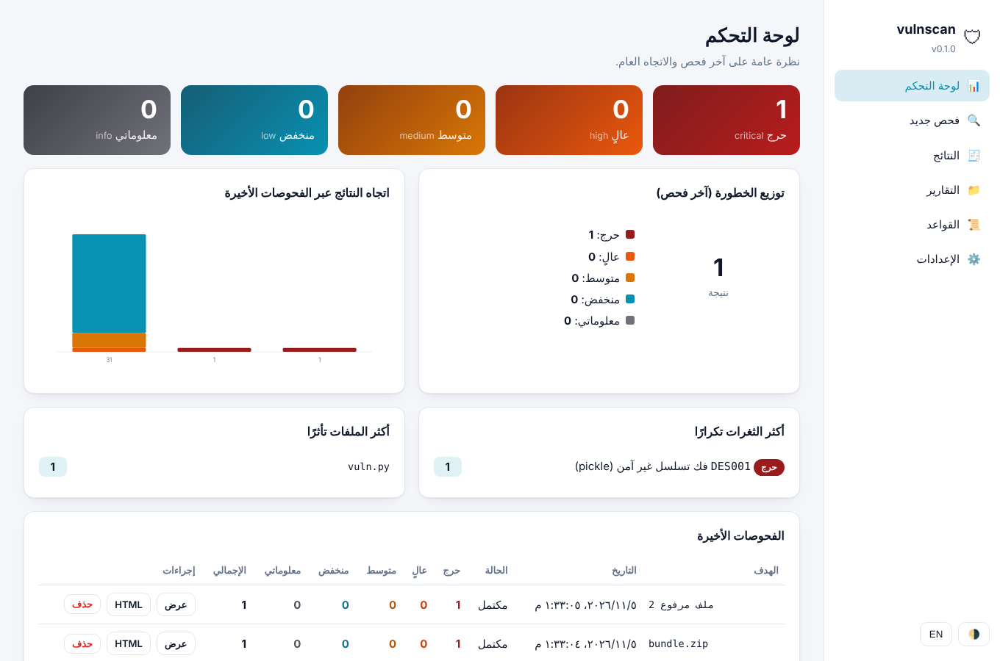
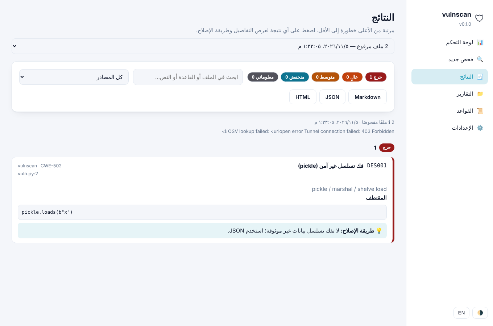
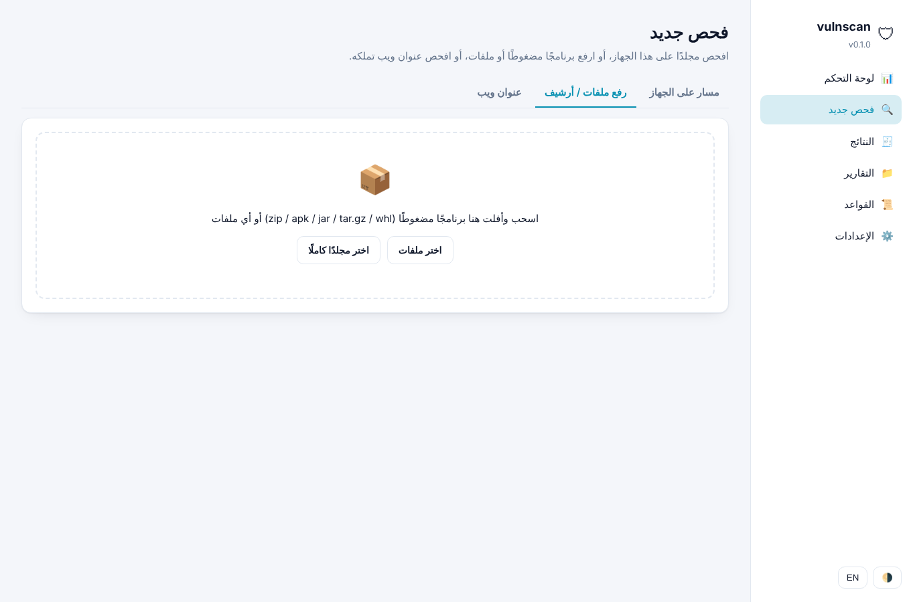
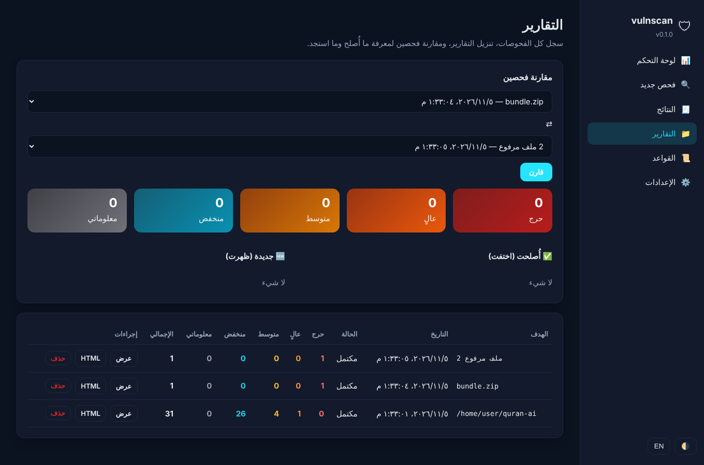

# كاشِف (vulnscan) — فاحص ثغرات مستقل لأي برنامج

> **كاشِف** هو الاسم العربي للأداة؛ و`vulnscan` هو اسم الأمر والحزمة التقني.

أداة بلغة Python (بدون أي اعتماديات خارجية) تفحص **أي برنامج** وتُخرج تقريرًا
مرتبًا **من الأعلى خطورة إلى الأقل**: حرج ← عالٍ ← متوسط ← منخفض ← معلوماتي.
تعمل من سطر الأوامر، أو من **واجهة رسومية محلية** بلوحة تحكم وتقارير وإعدادات.

| لوحة التحكم | النتائج مع طريقة الإصلاح |
|---|---|
|  |  |

| رفع برنامج مضغوط أو ملفات | التقارير والمقارنة (الوضع الداكن) |
|---|---|
|  |  |

> ⚠️ **الصلاحية أولًا:** افحص فقط ما تملكه أو ما لديك تصريح كتابي بفحصه. فحص أنظمة الآخرين دون إذن
> قد يكون مخالفًا للقانون. فحص عناوين الويب لا يعمل إلا مع العلامة `--authorized`.

## ماذا يفحص؟

| الهدف | مثال | ما يحدث |
|---|---|---|
| مجلد مصدر بأي لغة | `vulnscan ./my-app` | يمر على كل الملفات النصية ويطبّق 65+ قاعدة |
| ملف واحد | `vulnscan server.py` | يفحص الملف وحده |
| أرشيف / حزمة | `vulnscan app.apk` أو `.jar` `.zip` `.whl` `.tar.gz` | يفكّه في مجلد مؤقت ويفحص محتواه |
| عنوان ويب (سلبي) | `vulnscan https://my-site.example --authorized [--deep] [--crawl]` | ترويسات الأمان، الكوكيز، CSP، TLS، تحليل الصفحة وبصمة المنصّة؛ `--deep` للمسارات المكشوفة و`--crawl` لزحف الصفحات |

القواعد المدمجة تغطي: Python، JavaScript/TypeScript، Dart/Flutter، Java/Kotlin، Go، PHP، Ruby، C#، C/C++،
Shell، Dockerfile، docker-compose، GitHub Actions، AndroidManifest، iOS plist، وملفات الإعدادات.

فئات الثغرات: أسرار ومفاتيح مضمّنة، تنفيذ أوامر/كود (RCE)، حقن SQL/XSS/قوالب/مسارات، فك تسلسل غير آمن،
تشفير ضعيف وتعطيل TLS، إعدادات خطرة (debug، CORS، 0.0.0.0)، أمان الموبايل، أمان الحاويات و CI،
سلامة الذاكرة في C، تسجيل بيانات حساسة، وملفات لا يجوز شحنها (.env، مفاتيح SSH، قواعد بيانات).

### فحص الويب بعمق أكبر

الفحص الافتراضي لعنوان الويب سلبي بالكامل: يقرأ ما يخدمه الموقع فقط ولا يرسل أي بيانات في النماذج
ولا يجرّب أي حمولات. يغطّي:

- **ترويسات الأمان**: HSTS، CSP (مع كشف `unsafe-inline` و`unsafe-eval` و`*`)، X-Frame-Options،
  X-Content-Type-Options، Referrer-Policy، Permissions-Policy.
- **الكوكيز**: علامات Secure و HttpOnly و SameSite.
- **TLS والشهادة**: قبول TLS 1.0/1.1 القديم، وانتهاء الشهادة أو عدم صحتها.
- **تحليل الصفحة** (من نفس الطلب، بلا طلبات إضافية): محتوى مختلط على صفحة HTTPS، نماذج تُرسل عبر HTTP،
  حقل كلمة مرور في صفحة غير آمنة، سكربتات خارجية بلا SRI، إصدار jQuery قديم، عرض فهرس المجلدات،
  وأثر استثناء/تصحيح مسرَّب في الاستجابة.

مع `--deep` (أو خيار «فحص أعمق» في الواجهة) يُجري **عددًا محدودًا** من الطلبات الإضافية لملفات يشيع
تركها مكشوفة بالخطأ: `.git/HEAD`، `.env`، `.svn/entries`، `.DS_Store`، `server-status`، `phpinfo.php`،
و`security.txt`، مع قراءة `robots.txt`. لا يتجاوز ذلك قراءة ما هو متاح أصلًا، ولا يُجري أي اختبار نشط
(لا حقن، ولا تخمين، ولا تجاوز للحماية).

> ⚠️ كل فحص ويب يتطلب `--authorized` (أو تفعيل الإقرار في الواجهة). افحص فقط المواقع التي تملكها أو لديك
> تصريح كتابي بفحصها.

### تحليل تدفق البيانات (Taint) للغة Python

إضافةً إلى قواعد الأنماط، تحلّل الأداة ملفات Python عبر شجرة AST وتتعقّب البيانات من **مصادر غير موثوقة**
(مثل `request.args`/`form`/`json`، و`input()`، و`os.environ`، و`sys.argv`) عبر الإسنادات والعمليات حتى
**نقاط الخطر**: `eval`/`exec`، و`os.system`، و`subprocess` مع `shell=True`، و`cursor.execute` (حقن SQL)،
و`open`/`send_file` (اجتياز المسار)، و`pickle.loads`/`yaml.load`، و`render_template_string` (SSTI)، و`redirect`
(تحويل مفتوح). يلتقط ذلك التدفقات متعددة الخطوات التي لا تكشفها الأنماط:

```python
name = request.args["q"]
cmd  = "echo " + name
os.system(cmd)            # ← يُبلَّغ عنه: قيمة من request.args تصل إلى os.system
```

ويتجاهل القيمة الثابتة التي تصل إلى النقطة نفسها، كما يتوقف الإبلاغ إذا مرّت القيمة عبر مُعقّم مثل
`shlex.quote` أو `html.escape`. ومثال على التتبّع عبر الملفات:

```python
# io_mod.py
def read_name():  return request.args["name"]   # يعيد بيانات غير موثوقة
# exec_mod.py
def run(cmd):     os.system(cmd)                 # وسيط يصل إلى نقطة خطر
# views.py
run(read_name())   # ← يُبلَّغ عنه: التدفق يمرّ عبر ملفين ودالتين
``` النتائج تظهر بمصدر `taint` وتبدأ معرّفاتها بـ `DF`. التحليل يتتبّع التدفق **بين الدوال وعبر ملفات المشروع** (inter-procedural، cross-file) للغة Python، ببناء
ملخّص لكل دالة (هل تعيد بيانات غير موثوقة؟ أيّ وسيط يصل إلى نقطة خطر؟) وحلّ الاستيرادات، فيلتقط التدفقات
متعددة القفزات عبر دوال مساعدة في ملفات أخرى — مثل الأدوات الكبرى. حلّ الاستدعاءات عبر الملفات تقريبي
(بالاسم والاستيراد) لا محرّك كامل مدرك للأنواع.

### فحص تطبيقات الويب وصفحاتها (الزحف وبصمة المنصّات)

لفحص تطبيق ويب متعدد الصفحات مثل بوابة جامعة أو نظام **Moodle** أو تطبيق **Oracle APEX**، أضِف `--crawl`:
تتبع الأداة روابط الصفحات من **النطاق نفسه** زحفًا بالعرض (BFS) وتفحص كل صفحة بالفحوص السلبية.

```bash
vulnscan https://lms.jamiah.example --authorized --crawl --deep
```

- حدود الزحف: `--max-pages` (الافتراضي 20) و`--max-depth` (الافتراضي 2). لا تُتبع روابط الخروج/الحذف
  (logout، delete…) ولا الروابط الخارجة عن النطاق، ولا تُرسَل أي بيانات.
- **بصمة المنصّة**: تتعرّف الأداة تلقائيًا على Moodle وOracle APEX وWordPress وJoomla وDrupal وphpMyAdmin
  وLaravel من الصفحة والترويسات، وتنبّه إذا كان الإصدار قديمًا، وتذكّر بتحديث الإضافات والقوالب. ومع `--deep`
  تفحص مسارات الإدارة والدخول وملفات الإعداد الشائعة لكل منصّة (مثل `/login/index.php` و`/wp-login.php`
  و`/administrator/`).

> ⚠️ الزحف وفحص الويب يتطلبان `--authorized`. افحص فقط الأنظمة التي تملكها أو لديك تصريح كتابي بفحصها —
> فحص بوابة جامعة أو أي نظام لا تملكه دون إذن قد يكون مخالفًا للقانون.

### فك تجميع APK / JAR / AAR / DEX (jadx)

إذا كان [jadx](https://github.com/skylot/jadx) مثبّتًا (يحتاج Java 11+)، تُفكّ تجميع الحزم الثنائية تلقائيًا
إلى كود Java مع فك ترميز `AndroidManifest.xml` والموارد، وتُطبَّق عليها كل القواعد (تنفيذ الأوامر، الأسرار،
التشفير الضعيف، WebView، cleartext…). تظهر هذه النتائج بمسار `app.apk!decompiled/…` وبعلامة `jadx`.

- مكتبات الطرف الثالث الشائعة (androidx، kotlin، okhttp، firebase…) تُستبعد افتراضيًا لتقليل الضجيج؛
  فعّل فحصها بـ `--jadx-include-libs` أو من الإعدادات.
- بدون jadx تُفحص الملفات النصية داخل الحزمة فقط ويظهر تنبيه بذلك في التقرير.
- خيارات: `--no-jadx`، `--jadx-timeout SEC` (الافتراضي 600).

التثبيت: نزّل `jadx-x.y.z.zip` من صفحة الإصدارات وأضف مجلد `bin` إلى PATH، أو:
`brew install jadx` (macOS) · `scoop install jadx` / `choco install jadx` (Windows) · `sudo apt install jadx` (Debian/Ubuntu).

بالإضافة إلى ذلك، وعند توفر الإنترنت:
- **ثغرات الاعتماديات المعروفة (CVE)** عبر [OSV.dev](https://osv.dev) من `requirements.txt`،
  `package-lock.json`، `package.json`، `pubspec.lock`، `go.mod`، `Gemfile.lock`، `composer.lock`.
- **دمج أدوات خارجية** إن كانت مثبّتة (اختياري تمامًا): `bandit`، `semgrep`، `gitleaks`، `npm audit`.

## التثبيت

```bash
pip install git+https://github.com/abdulrahmanahmedelabed-prog/vulnscan
```

أو بدون تثبيت:

```bash
git clone https://github.com/abdulrahmanahmedelabed-prog/vulnscan
cd vulnscan
python -m vulnscan /path/to/project
```

## نسخة exe جاهزة (بلا تثبيت Python)

نزّل الملف المناسب من [صفحة الإصدارات](https://github.com/abdulrahmanahmedelabed-prog/vulnscan/releases/latest):

| النظام | الملف |
|---|---|
| ويندوز | `vulnscan-windows.exe` — انقر مرّتين لفتح الواجهة |
| macOS | `vulnscan-macos` |
| لينكس | `vulnscan-linux` |

النسخ تُبنى آليًا عبر GitHub Actions بواسطة PyInstaller من ملف `vulnscan.spec`، وتتضمن الواجهة كاملة.
لبنائها محليًا: `pip install pyinstaller` ثم `pyinstaller --clean --noconfirm vulnscan.spec` (الناتج في `dist/`).

**صفحة الهبوط**: موقع تعريفي في `site/` يُنشر على GitHub Pages ويتضمن المقارنة مع الأدوات العالمية.

## التشغيل بنقرة واحدة

بعد تنزيل المشروع وفكّ ضغطه، وتثبيت [Python 3](https://www.python.org/downloads/) (على ويندوز فعّل خيار **Add Python to PATH**):

| النظام | الملف |
|---|---|
| ويندوز | انقر مرّتين على **`run.bat`** |
| macOS | انقر مرّتين على **`run.command`** |
| لينكس | شغّل **`./run.sh`** |

يفتح المتصفح تلقائيًا على الواجهة. اترك النافذة مفتوحة، وللإيقاف اضغط `Ctrl+C`.

## الواجهة الرسومية

```bash
vulnscan ui
```

يفتح المتصفح على `http://127.0.0.1:8765` (الخادم يستمع على هذا الجهاز فقط ولا يُعرَّض للشبكة):

- **لوحة التحكم**: بطاقات العدّ لكل خطورة، مخطط دائري للتوزيع، اتجاه النتائج عبر الفحوصات الأخيرة،
  أكثر الثغرات تكرارًا، أكثر الملفات تأثرًا، وآخر الفحوصات.
- **فحص جديد**: مسار مجلد/ملف/أرشيف على الجهاز، أو **رفع** (سحب وإفلات) أي برنامج مضغوط
  (zip / apk / jar / aar / war / whl / ipa / tar.gz) أو أي عدد من الملفات أو مجلد كامل من المتصفح،
  أو عنوان ويب مع إقرار الصلاحية. تُحذف الملفات المرفوعة بعد الفحص.
- **النتائج**: مرتبة من الأعلى خطورة إلى الأقل، مع فلاتر بالخطورة والمصدر وبحث نصي، وبطاقة لكل نتيجة
  تُفتح لعرض المقتطف وCWE وطريقة الإصلاح، وتنزيل Markdown / JSON / HTML.
- **التقارير**: سجل الفحوصات، تنزيل التقارير، و**مقارنة فحصين** لمعرفة ما أُصلح وما استجد.
- **القواعد**: استعراض كل القواعد المدمجة مع البحث.
- **الإعدادات**: أدنى خطورة، الاستثناءات، القواعد المتجاهَلة، OSV، الأدوات الخارجية، العناوين المصرَّح بها.
- عربي/إنجليزي، فاتح/داكن/تلقائي، ومتجاوب مع شاشات الجوال.

تُحفظ البيانات في `~/.vulnscan` (أو المجلد في `VULNSCAN_HOME`). خيارات: `--port`، `--no-browser`.

## الاستخدام من سطر الأوامر

```bash
# تقرير ملوّن على الشاشة
vulnscan ./my-project

# تقارير Markdown + JSON + HTML دفعة واحدة
vulnscan ./my-project --all-formats report

# تقرير HTML فقط إلى ملف
vulnscan app.apk -f html -o report.html

# في CI: أفشل البناء إذا وُجد شيء عالٍ أو حرج
vulnscan . --fail-on high --exclude "tests/*"

# دون إنترنت ودون أدوات خارجية
vulnscan . --no-deps --no-external

# فحص سلبي لموقع تملكه
vulnscan https://my-site.example --authorized

# عرض القواعد
vulnscan --list-rules .
```

### الخيارات

| الخيار | الوصف |
|---|---|
| `-f console\|markdown\|json\|html` | صيغة التقرير |
| `-o FILE` | كتابة التقرير إلى ملف |
| `--all-formats PREFIX` | كتابة `PREFIX.md` و `PREFIX.json` و `PREFIX.html` |
| `--min-severity LEVEL` | عرض هذه الخطورة فما فوق |
| `--fail-on LEVEL` | رمز خروج 1 عند وجود نتيجة بهذه الخطورة أو أعلى |
| `--exclude GLOB` | استثناء مسارات (يُكرَّر) |
| `--ignore-rule ID` | تجاهل قاعدة (يُكرَّر) |
| `--no-deps` / `--no-external` | تعطيل OSV / الأدوات الخارجية |
| `--no-jadx` / `--jadx-timeout SEC` / `--jadx-include-libs` | التحكم في فك التجميع عبر jadx |
| `--authorized` | إقرار بالصلاحية (إلزامي لعناوين الويب) |
| `--deep` | فحص ويب أعمق (تحليل الصفحة ومسارات مكشوفة شائعة) |
| `--crawl` / `--max-pages` / `--max-depth` | زحف على صفحات الموقع وفحصها (لتطبيقات مثل Moodle وAPEX) |

### كتم إنذار مقصود

أضف في نهاية السطر `# nosec` أو `// vulnscan: ignore`. ولكتم ملف كامل ضع `vulnscan: ignore-file`
في أول سطوره.

## شكل التقرير

```
vulnscan — ./my-project  (156 ملفًا مفحوصًا، 37 نتيجة)

الملخص (من الأعلى خطورة إلى الأقل):
        حرج  CRITICAL 0
       عالٍ  HIGH     3
      متوسط  MEDIUM   8
      منخفض  LOW      26
   معلوماتي  INFO     0

━━ عالٍ / HIGH (3) ━━
  🟧 MOB001 [CWE-319] السماح بحركة مرور غير مشفّرة — Cleartext traffic allowed
     📄 app/android/app/src/main/AndroidManifest.xml:6
     ▸ android:usesCleartextTraffic="true"
     💡 عطّل cleartext واستخدم HTTPS فقط …
```

تقرير Markdown يبدأ بملخص تنفيذي وجدول أعداد، ثم «أهم ما يجب إصلاحه أولًا»، ثم كل النتائج مجمّعة حسب الخطورة
مع المعرّف و CWE والموضع والمقتطف وطريقة الإصلاح. تقرير JSON يحمل الحقول نفسها لدمجه في أدوات أخرى.

## مقارنة مع الأدوات العالمية

| | **vulnscan** | Semgrep | SonarQube | Snyk Code | GitHub CodeQL | Bandit | Trivy |
|---|---|---|---|---|---|---|---|
| نوع التحليل | أنماط + تدفق بيانات (Python، بين الدوال وعبر الملفات) | أنماط دلالية + تتبع بيانات (Pro) | تحليل دلالي عميق | تحليل دلالي + تعلّم آلي | تحليل تدفق بيانات بلغة استعلام | AST لـ Python | إعدادات + اعتماديات + حاويات |
| اللغات | 15+ لغة وملفات إعداد | 30+ | 30+ | 15+ | 10+ | Python فقط | — (لا كود) |
| كشف الأسرار | ✅ | محدود | ✅ (نسخ مدفوعة) | ✅ | ✅ | ❌ | ✅ |
| ثغرات الاعتماديات (CVE) | ✅ عبر OSV.dev | ✅ (Supply Chain) | محدود | ✅ قوي | ✅ Dependabot | ❌ | ✅ قوي |
| فحص أرشيف / APK / JAR | ✅ + فك تجميع عبر jadx | ❌ | ❌ | ❌ | ❌ | ❌ | ✅ (صور وملفات) |
| فحص ويب سلبي (ترويسات/CSP/TLS/شهادة/مسارات مكشوفة) | ✅ | ❌ | ❌ | محدود (SaaS) | ❌ | ❌ | ❌ |
| واجهة رسومية محلية | ✅ بلا خادم خارجي | ❌ (SaaS) | ✅ (تحتاج خادم وقاعدة بيانات) | SaaS | على GitHub | ❌ | ❌ |
| التقرير مرتّب حسب الخطورة | ✅ أساسًا | ✅ | ✅ | ✅ | ✅ | ✅ | ✅ |
| مقارنة فحصين (ما أُصلح/ما استجد) | ✅ | في SaaS | ✅ | ✅ | ✅ | ❌ | ❌ |
| يعمل دون إنترنت | ✅ (عدا OSV) | ✅ محليًا | ✅ | ❌ | ✅ CLI | ✅ | ✅ (بعد تنزيل DB) |
| الاعتماديات | **صفر** (Python فقط) | ثنائي + قواعد | Java + DB | حساب Snyk | CodeQL CLI | pip | ثنائي Go |
| العربية | ✅ عناوين وإصلاحات بالعربية | ❌ | ❌ | ❌ | ❌ | ❌ | ❌ |
| السعر | مجاني (MIT) | مجاني/مدفوع | Community/مدفوع | مجاني محدود/مدفوع | مجاني للمفتوح | مجاني | مجاني |

**أين يتفوق vulnscan؟** خفيف جدًا وبلا اعتماديات، يُغطي عدة لغات وملفات الإعداد والحاويات وCI والموبايل
في أداة واحدة، يقبل الأرشيفات وAPK مباشرة، واجهته وتقاريره بالعربية، ويدمج تلقائيًا نتائج Semgrep وBandit
وgitleaks وnpm audit إن وُجدت فيصبح لوحة واحدة فوقها.

**أين تتفوق الأدوات العالمية؟** CodeQL وSemgrep Pro وSonarQube وSnyk تُجري **تحليل تدفق بيانات** حقيقيًا
(تتبع المدخلات من المصدر إلى الاستخدام الخطر) فتكشف ثغرات لا تظهر بالأنماط وتُقلّل الإنذارات الكاذبة،
ولديها آلاف القواعد وتكاملات IDE وPR. لذلك يُنصح بتشغيل vulnscan كطبقة أولى سريعة، وتثبيت `semgrep`
بجانبه ليدمج نتائجه تلقائيًا عند الحاجة إلى عمق أكبر.

## التطوير

```bash
pip install -e .[dev]
python -m pytest -q
```

البنية: `scanner.py` (المشي على الملفات والأرشيفات) · `rules.py` (القواعد) · `deps.py` (OSV) · `web.py` (الفحص السلبي)
· `external.py` (الأدوات الخارجية) · `report.py` (التقارير) · `server.py` + `ui/` (الواجهة) · `store.py` (الإعدادات والسجل) · `cli.py`.

## حدود الأداة

- الفحص الثابت بالقواعد يكشف الأنماط الشائعة ولا يغني عن مراجعة بشرية أو اختبار اختراق.
- قد تظهر إنذارات كاذبة؛ استخدم `--ignore-rule` أو كتم السطر بعد التحقق.
- بدون jadx تُفحص محتويات APK/JAR النصية فقط؛ ومع jadx يُفحص الكود المفكوك وهو كود مُعاد توليده قد يختلف عن المصدر الأصلي.
- فحص الويب سلبي بالكامل (طلب واحد) ولا يُجري أي اختبار نشط.

## الرخصة

MIT
